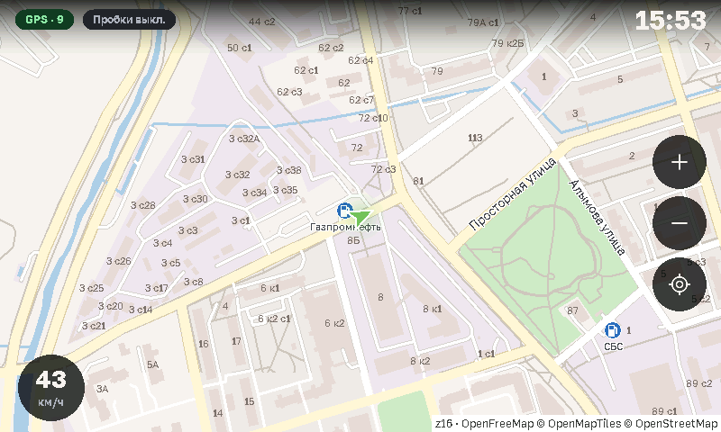
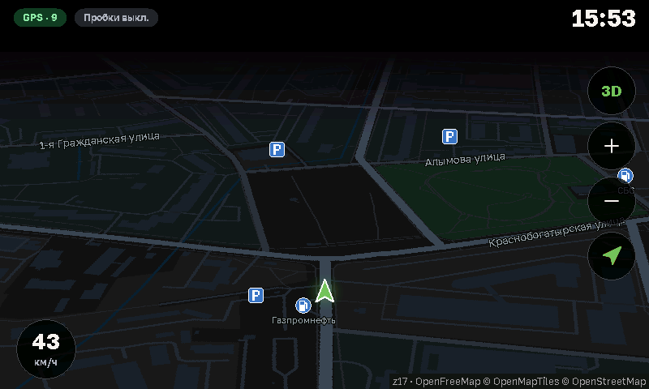
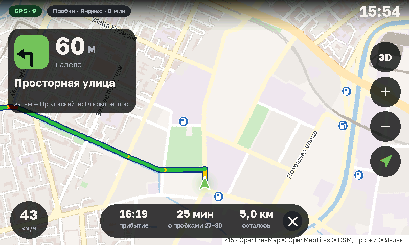

# OSMapsCE

**[Русская версия](README.md)**

OSMapsCE is a navigation app on [OpenStreetMap](https://www.openstreetmap.org) maps for Windows CE devices with an
800×480 screen. Its main device is the Lada Vesta MMC head unit (HU). The app shows the map and traffic, finds
addresses, lays a route and guides you along it by voice. Search, routes and the vector map also work without internet
access once you download region maps. The app is free.

The version is shown in "Настройки → О программе" (Settings → About). The number looks like `2.1.YYMMDD`: the end is
the build date.

| Day | Night, 3D view | Route: traffic on the route |
|---|---|---|
|  |  |  |

The labels in quotes are the app's Russian labels as they appear on the screen, with a translation where it helps.
With the English interface ([section 11](#11-languages)) the screen shows the English labels instead.

## Features

- **Map.** Raster (OSM tiles) or vector (OpenFreeMap). Day and night. A third-person view ("3D"). Places you have
  viewed are kept in a cache.
- **Offline.** A downloaded region gives a vector map, address search and routes. Between regions, routes follow the
  main roads.
- **Traffic** from Yandex or 2GIS: on the map or only on the route line. Travel time with traffic.
- **Routes:** your own starting point, up to three stops, several alternatives to choose from, avoiding toll roads.
- **Guidance:** a maneuver card, a diagram of complex junctions, the arrival time, rerouting when you leave the route.
  In a tunnel without GPS the marker moves on along the route. After a restart the app offers to continue the route.
- **Voice prompts** in Russian or English, without internet access. On the Lada Vesta they play over the radio.
- **Favorites:** up to 12 places, each with its own sign.
- **Layers of a downloaded region:** traffic lights, speed bumps with a warning on the way, car parks, Moscow's paid
  street parking with prices. The road's speed limit sign.
- **Interface languages:** Russian and English. A new language is one text file.
- **With VestaHome:** the "Карта OSM" (OSM map) widget on the home screen, the theme color, a shared day / night
  mode, the maneuver in VestaHome's top bar, zoom with the steering wheel buttons.

## Installing

1. Download the `OSMapsCE-<version>.zip` archive from [Releases](../../releases).
2. Unpack the `OSMapsCE` folder to the device's memory card.
3. Run `OSMapsCE.exe`.

See the [user guide](docs/manual.en.md) for details.

## Documentation

- [User guide](docs/manual.en.md)
- [Руководство на русском](docs/manual.md)

## Building

C++, Win32 API, sources in [native_osm](native_osm). Requires Visual Studio 2005 with Smart Device support and the
Pocket PC 2003 SDK.

1. `git submodule update --init` fetches the [VestaCore](https://github.com/TpuPyku/VestaCore) module into `core`.
2. `native_osm\build_bearssl.bat`, once: BearSSL for ARM and x86.
3. `native_osm\build.bat` builds `OSMapsCE\OSMapsCE.exe` (ARMv4, Windows CE) and `OSMapsCE\OSMapsPC.exe` (for testing
   on a PC: the arrows move the map, `+`/`-` and the mouse wheel zoom; `T` traffic, `L` source, `G` GPS, `S` settings,
   `N` night, `F3` search, `Esc` exit).

Tests: `native_osm\test_offline.bat`, `test_vtile.bat`, `test_ui.bat` (route start and translations),
`test_stamp.bat`, `test_voice.bat`, and `python -m unittest test_maps` in `offline\test`. The map build is in
[offline](offline) and the `maps` workflow.

Tools: `core\make_ta.py` for root certificates; `native_osm\make_regions.py` for 2GIS cities (needs a key in
`native_osm\.env`, not part of the app).

Third-party libraries: [BearSSL](https://bearssl.org) 0.6 (MIT) for HTTPS; [stb_image](https://github.com/nothings/stb)
(public domain) for PNG/JPEG. See `THIRD_PARTY.txt`.

## License

© 2026 TpuPyku, GNU GPL v3 (`LICENSE`): you may use, change and distribute it, including for money, only together with
the source code of all changes under the same license. Map data © OpenStreetMap contributors, ODbL.

## Other apps

- [VestaHome](https://github.com/TpuPyku/VestaHome) — a shell for the Lada Vesta HU.
- [YaMapsCE](https://github.com/TpuPyku/YaMaps) — Yandex map with traffic.
- [VestaLaunch](https://github.com/TpuPyku/VestaLaunch) — starts apps from the "Навигация" button.

## Support the project

OSMapsCE is free. If you like it:

- give the repository a ⭐ star (the **Star** button at the top of the page) — it helps others find OSMapsCE;
- support the development on [Boosty](https://boosty.to/vesta_home) — voluntary, everything stays free.
