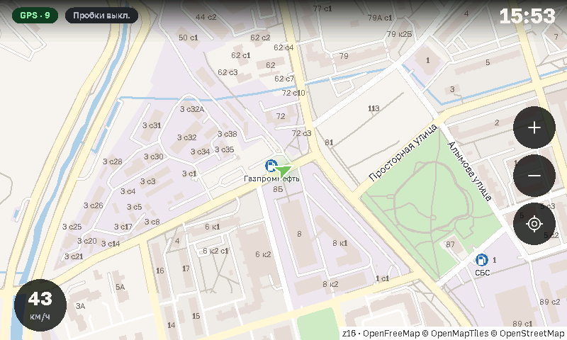
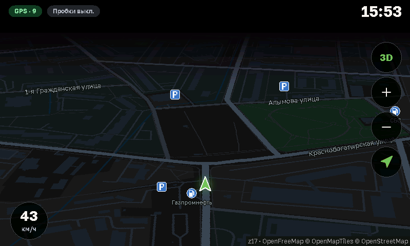
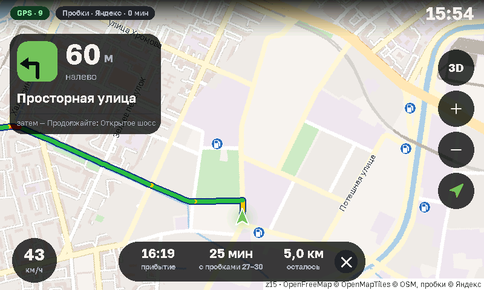

# OSMapsCE

**[Русская версия](README.md)**

A navigation app on [OpenStreetMap](https://www.openstreetmap.org) maps for Windows CE devices with an 800×480 screen: map, search and routes, including offline, plus traffic. On the Lada Vesta MMC head unit (before 2021) with the [VestaHome](https://github.com/TpuPyku/VestaHome) shell it also supports color themes and a home screen widget.

| Day | Night, 3D view | Route: traffic on the route |
|---|---|---|
|  |  |  |

## Features
- **Offline:** regions of Russia and the CIS with a map, address search and routes. Routes between regions follow the main roads.
- **Map:** raster (OSM tiles) or vector (OpenFreeMap) with day and night palettes, a 3D view, bridges, tunnels, house numbers, filling stations and car parks. Places you have viewed are cached.
- **Routes:** search for addresses and places, turn guidance, rerouting when you leave the route, alternatives with time estimates, avoiding toll roads, a card for complex junctions.
- **Route editor:** long press on the map, up to three stops, your own starting point. Without a GPS signal, a route starts from the last known location, or from the map center if GPS has not worked yet. Favorite places show on the map.
- **Traffic:** updated every 10 minutes. In the map settings, "Traffic: Route" shows it on the route line only.
- **OSM layers:** one button cycles traffic, car parks, neither; paid car parks are red, free ones green, unknown ones grey. Traffic lights and speed bumps have their own switches in the map settings, and a caption warns of a bump ahead. They need a region package built with these layers.
- **Moscow paid street parking:** lines along the streets from z15, colored by the price for the current day and hour (the device's clock): red is paid, green is free right now. From z16 the lines show the car price in rubles per hour. Public holidays are not recognized, so the usual price shows. Data: [Moscow Government Open Data Portal](https://data.mos.ru/opendata/623), version of 2026-01-20; prices may have changed, so check the signs.
- **GPS:** the car on the map, north-up and heading-up modes.
- **Interface language:** Russian or English, in Настройки → Язык / Language (Settings → Language). Map labels and region names stay in Russian or the local language. For another language, add a file to the `Lang` folder: a copy of `en.txt` with your translation.
- **On the Lada Vesta with VestaHome:** the theme color and a map widget on the home screen. During a route the widget shows the road and the maneuver, and other screens show the maneuver in the top bar.

## Outside Russia and the CIS
Online mode is not tied to a region: map tiles, search and routing use worldwide services, so it should work elsewhere, although it has not been tested there. Offline maps cover only Russia and the CIS. Traffic comes from Yandex and 2GIS, so coverage in other countries may be limited.

## Installation
1. Download the archive from [Releases](../../releases) and unpack the `OSMapsCE` folder to a memory card.
2. Run `OSMapsCE.exe`.

`OSMapsCE.ini` (settings) and a `Cache` folder (tiles) appear next to it.

## Offline maps
There are two ways to install regions:
- **On the device:** Settings → MAPS. This needs internet access.
- **From a computer:** the `OSMapsCE-Maps` program from the [maps-app](../../releases/tag/maps-app) release writes the chosen regions to a flash drive or memory card.

The data goes into an `OSMapsData` folder in the root of any volume on the device. A region takes about 125 MB on average, and the largest takes about 1.3 GB. A region comes with the overview and main roads pack, which provides the small zoom levels and routes between regions.

Maps are rebuilt every week.

## GPS
The app only reads the GPS port and picks NMEA sentences from the stream. The default is `COM4:` at 115200. For another device, use Settings → GPS → FIND GPS, which tries COM1…COM9 and the common speeds, or set the port and speed by hand.
Port errors:
- The NMEA counter in the settings does not grow: wrong port.
- Many lines with errors: wrong speed.

## Settings (`OSMapsCE.ini`)
Almost everything can be changed on screen. Edit the file only while the app is closed.

| Key | Default | Description |
|---|---|---|
| `traffic_src` | yandex | traffic source: yandex / 2gis |
| `traffic_route` | 0 | 1: traffic on the route line only |
| `traffic_ttl` | 10 | traffic update interval, minutes |
| `yandex_limit`, `2gis_limit` | 900, 2000 | traffic requests per day |
| `auto_reserve` | 100 | part of the limit kept for manual updates |
| `api_limit` | 300 | search and route requests per day |
| `vector` | 0 | map type: 0 raster, 1 vector |
| `cache_mb` | 500 | map cache size, MB |
| `cache_days` | 7 | days before a tile is checked against the server (0: never) |
| `gps`, `gps_port@<device>`, `gps_baud@<device>` | 1, COM4:, 115200 | GPS on/off, port, speed (0: leave as is); port and speed are kept per device, so one card can serve two devices |
| `kill` | CityGuideCE.exe | program to close if it holds the GPS port (empty: never) |
| `hide_taskbar` | 1 | hide the taskbar |
| `lang` | empty | interface language: the file `Lang\<lang>.txt`, empty for Russian |
| `log` | 0 | log; also switched in Settings → Log |

The other keys hold the app's state and counters.

## Data sources and their rules
- **Raster map:** [OpenStreetMap](https://operations.osmfoundation.org/policies/tiles/) tiles over HTTPS, cached. Bulk downloading is forbidden.
- **Vector map:** [OpenFreeMap](https://openfreemap.org), OpenMapTiles data. Offline region tiles are cut from [Protomaps](https://protomaps.com) builds. Road graphs and search are built from [Geofabrik](https://download.geofabrik.de) and [openstreetmap.fr](https://download.openstreetmap.fr) extracts.
- **Yandex traffic:** the Static API without a key. Regularly exceeding the limit blocks access. [Terms](https://yandex.ru/dev/commercial/doc/ru/).
- **2GIS traffic:** tiles from the [RasterJS API](https://github.com/2gis/mapsapi) library's server (over 200 cities). The address may change. Non-commercial use only, under the [2GIS license](https://github.com/2gis/mapsapi/blob/master/LICENSE).
- **Search:** [Photon](https://photon.komoot.io), requested only when you press the search button.
- **Routing:** OSRM on [FOSSGIS](https://routing.openstreetmap.de) servers, without traffic.

Search and routing use free servers meant for moderate use, hence `api_limit`. Map data © OpenStreetMap contributors, [ODbL](https://www.openstreetmap.org/copyright).

## Troubleshooting
- Turn the log on in Settings → Log. `OSMapsCE.log` records requests, network errors, GPS and cache (up to 256 KB, the previous part is in `OSMapsCE.old.log`).
- "HTTPS error" usually means a wrong date on the device and no GPS signal.
- Delete `OSMapsCE.ini` to restore the default settings. The `Cache` folder can be deleted too.

## Building
C++, Win32 API, sources in [native_osm](native_osm). Requires Visual Studio 2005 with Smart Device support and the Pocket PC 2003 SDK.

1. `git submodule update --init` fetches the [VestaCore](https://github.com/TpuPyku/VestaCore) module into `core`.
2. `native_osm\build_bearssl.bat`, once: BearSSL for ARM and x86.
3. `native_osm\build.bat` builds `OSMapsCE\OSMapsCE.exe` (ARMv4, Windows CE) and `OSMapsCE\OSMapsPC.exe` (for testing on a PC: arrows, `+`/`-` and the mouse wheel for zoom; `T` traffic, `L` source, `G` GPS, `S` settings, `N` night, `F3` search).

Tests: `native_osm\test_offline.bat`, `native_osm\test_vtile.bat`, `native_osm\test_ui.bat` (route start and translations), and `python -m unittest test_maps` in `offline\test`. The map build is in [offline](offline) and the `maps` workflow.

Tools: `core\make_ta.py` for root certificates; `native_osm\make_regions.py` for 2GIS cities (needs a key in `native_osm\.env`, not part of the app).

Third-party libraries: [BearSSL](https://bearssl.org) 0.6 (MIT) for HTTPS; [stb_image](https://github.com/nothings/stb) (public domain) for PNG/JPEG. See `THIRD_PARTY.txt`.

## License
© 2026 TpuPyku, GNU GPL v3 (`LICENSE`): you may use, change and distribute it, including for money, only together with the source code of all changes under the same license. Map data © OpenStreetMap contributors, ODbL.
