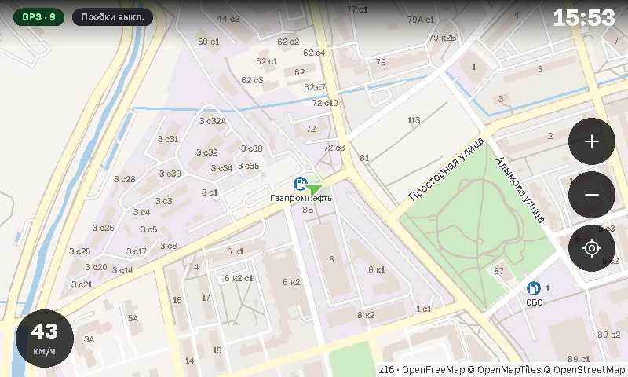
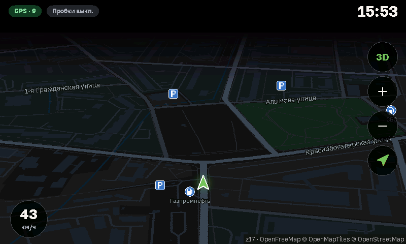
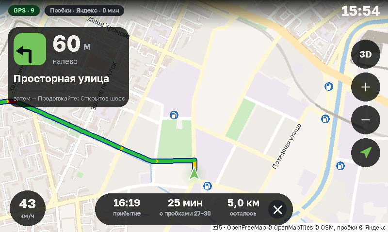

# OSMapsCE

**[English version](README.en.md)**

Навигатор на картах [OpenStreetMap](https://www.openstreetmap.org) для устройств на Windows CE с экраном 800×480: карта, поиск и маршруты, в том числе без интернета, и пробки. Для MMC Лады Веста (до 2021 года) с оболочкой [VestaHome](https://github.com/TpuPyku/VestaHome) есть цветовые темы и виджет главного экрана.

| День | Ночь, вид 3D | Маршрут: пробки на пути |
|---|---|---|
|  |  |  |

## Возможности
- **Без интернета:** области России и СНГ с картой, поиском адресов и маршрутами. Между областями маршрут идёт по магистралям.
- **Карта:** растровая (плитки OSM) или векторная (OpenFreeMap) с дневной и ночной палитрой, вид 3D, мосты, тоннели, номера домов, АЗС и парковки. Просмотренные места кэшируются.
- **Маршрут:** поиск адресов и мест, подсказки манёвров, перестроение при съезде, варианты с оценкой времени, объезд платных дорог, карточка сложной развязки.
- **Редактор маршрута:** долгое нажатие на карту, до трёх промежуточных точек, своё начало пути. Без сигнала GPS маршрут начинается с последнего известного места, а если GPS ещё не работал — от центра карты. Избранные места видны на карте.
- **Пробки** обновление раз в 10 минут. В настройках карт «Пробки: Маршрут» показывает их только на линии пути.
- **GPS:** машина на карте, режимы «север вверх» и «по курсу».
- **Язык интерфейса:** русский или английский, «Настройки → Язык / Language». Другой язык — файл в папке `Lang`: копия `en.txt` со своим переводом.
- **На Lada Vesta с VestaHome:** цвет темы и виджет карты на главном экране. Во время маршрута виджет показывает дорогу и манёвр, на других экранах манёвр виден в верхнем баре.

## Установка
1. Скачать архив из [Releases](../../releases), распаковать папку `OSMapsCE` на карту памяти.
2. Запустить `OSMapsCE.exe`.

Рядом появятся `OSMapsCE.ini` (настройки) и папка `Cache` (плитки).

## Карты без интернета
Есть два способа поставить области:
- **На устройстве:** «Настройки → КАРТЫ», нужен интернет.
- **С компьютера:** программа `OSMapsCE-Maps` из релиза [maps-app](../../releases/tag/maps-app) записывает выбранные области на флешку или карту памяти.

Данные лежат в папке `OSMapsData` в корне любого тома устройства. Область в среднем занимает около 125 МБ, самая большая — около 1,3 ГБ. Вместе с областью ставится пакет «Обзорная карта и магистрали», он нужен для мелких масштабов и маршрутов между областями.

Карты обновляются каждую неделю. Сейчас есть только Россия и страны СНГ.

## GPS
Программа только читает порт GPS и выбирает из потока строки NMEA. По умолчанию `COM4:` 115200; для другого устройства — «Настройки → Поиск GPS» (перебор COM1…COM9 и скоростей) или порт и скорость вручную.
Ошибки порта:
- Счётчик NMEA в настройках не растёт — не тот порт.
- Много строк с ошибкой — не та скорость.

## Настройки (`OSMapsCE.ini`)
Почти всё меняется на экране; файл правят при закрытой программе.

| Ключ | По умолчанию | Описание |
|---|---|---|
| `traffic_src` | yandex | источник пробок: yandex / 2gis |
| `traffic_route` | 0 | 1 — пробки только на линии маршрута |
| `traffic_ttl` | 10 | обновление пробок, минут |
| `yandex_limit`, `2gis_limit` | 900, 2000 | запросов пробок в сутки |
| `auto_reserve` | 100 | запас лимита для ручных обновлений |
| `api_limit` | 300 | запросов поиска и маршрута в сутки |
| `vector` | 0 | вид карты: 0 — растровая, 1 — векторная |
| `cache_mb` | 500 | размер кэша карты, МБ |
| `cache_days` | 7 | через сколько дней сверять плитку с сервером (0 — никогда) |
| `gps`, `gps_port@<устройство>`, `gps_baud@<устройство>` | 1, COM4:, 115200 | GPS вкл/выкл, порт, скорость (0 — не менять); порт и скорость — для каждого устройства свои (одна карта в ГУ и в другом навигаторе) |
| `kill` | CityGuideCE.exe | программа, которую закрыть, если держит порт GPS (пусто — никогда) |
| `hide_taskbar` | 1 | скрывать панель задач |
| `lang` | пусто | язык интерфейса: файл `Lang\<lang>.txt`, пусто — русский |
| `log` | 0 | журнал; включается и кнопкой «Настройки → ЖУРНАЛ» |

Остальные ключи — состояние программы и счётчики.

## Источники и их правила
- **Растровая карта** — плитки [OpenStreetMap](https://operations.osmfoundation.org/policies/tiles/) по HTTPS, с кэшем; массовая выкачка запрещена.
- **Векторная карта** — [OpenFreeMap](https://openfreemap.org), данные OpenMapTiles. Офлайн-плитки областей вырезаются из сборок [Protomaps](https://protomaps.com), графы и поиск строятся из выгрузок [Geofabrik](https://download.geofabrik.de) и [openstreetmap.fr](https://download.openstreetmap.fr).
- **Пробки Яндекса** — Static API без ключа; при регулярном превышении лимита доступ блокируется. [Условия](https://yandex.ru/dev/commercial/doc/ru/).
- **Пробки 2ГИС** — плитки сервера библиотеки [RasterJS API](https://github.com/2gis/mapsapi) (более 200 городов), адрес может измениться; только некоммерческое использование по [лицензии 2ГИС](https://github.com/2gis/mapsapi/blob/master/LICENSE).
- **Поиск** — [Photon](https://photon.komoot.io), запрос только по кнопке «Найти».
- **Маршрут** — OSRM на серверах [FOSSGIS](https://routing.openstreetmap.de), без учёта пробок.

Поиск и маршрут — бесплатные серверы для умеренного использования, отсюда лимит `api_limit`. Данные карт © участники OpenStreetMap, [ODbL](https://www.openstreetmap.org/copyright).

## Если что-то не так
- Журнал включается в «Настройки → ЖУРНАЛ»: `OSMapsCE.log` — запросы, ошибки сети, GPS, кэш (до 256 КБ, прошлая часть — `OSMapsCE.old.log`).
- «Ошибка HTTPS» — чаще всего неверная дата на устройстве и нет сигнала GPS.
- Удалите `OSMapsCE.ini` — вернутся настройки по умолчанию; папку `Cache` можно удалить.

## Сборка
C++, Win32 API, исходники в [native_osm](native_osm). Нужна Visual Studio 2005 с Smart Device и SDK Pocket PC 2003.

1. `git submodule update --init` — модуль [VestaCore](https://github.com/TpuPyku/VestaCore) в `core`.
2. `native_osm\build_bearssl.bat` — один раз, BearSSL для ARM и x86.
3. `native_osm\build.bat` — `OSMapsCE\OSMapsCE.exe` (ARMv4, Windows CE) и `OSMapsCE\OSMapsPC.exe` (проверка на ПК: стрелки, `+`/`-`, колесо — масштаб; `T` пробки, `L` источник, `G` GPS, `S` настройки, `N` ночь, `F3` поиск).

Проверки: `native_osm\test_offline.bat`, `native_osm\test_vtile.bat`, `native_osm\test_ui.bat` (маршрут и переводы), `python -m unittest test_maps` в `offline\test`. Сборка карт — [offline](offline) и workflow `maps`.

Служебные: `core\make_ta.py` — корневые сертификаты; `native_osm\make_regions.py` — города 2ГИС (нужен ключ в `native_osm\.env`, в программу не входит).

Сторонние библиотеки: [BearSSL](https://bearssl.org) 0.6 (MIT) — HTTPS; [stb_image](https://github.com/nothings/stb) (public domain) — PNG/JPEG. Подробнее — `THIRD_PARTY.txt`.

## Лицензия
© 2026 TpuPyku, GNU GPL v3 (`LICENSE`): можно использовать, изменять и распространять, в том числе за деньги, только вместе с исходным кодом всех изменений под той же лицензией. Данные карт © участники OpenStreetMap, ODbL.
