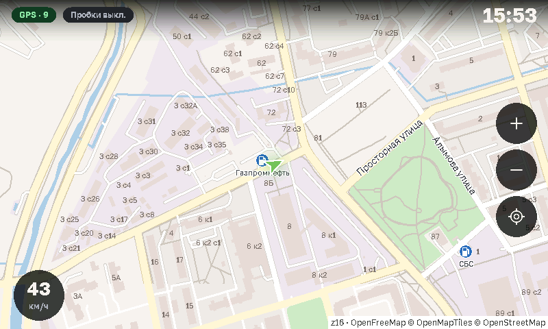
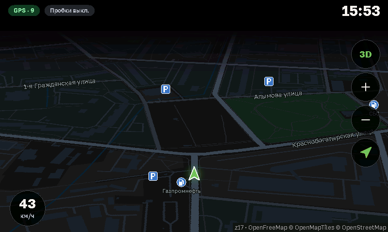
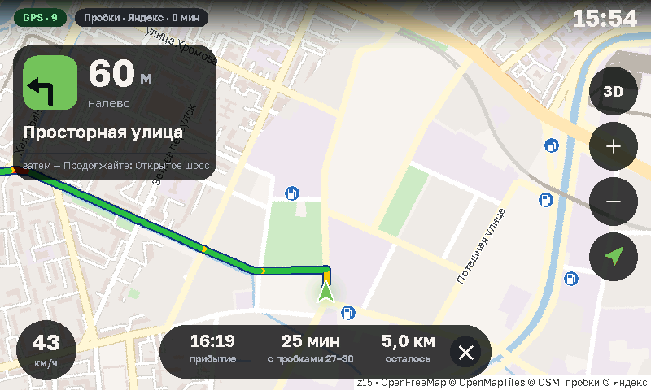

# OSMapsCE

**[English version](README.en.md)**

OSMapsCE — навигатор на картах [OpenStreetMap](https://www.openstreetmap.org) для устройств на Windows CE с экраном
800×480. Главное устройство — головное устройство (ГУ) MMC Lada Vesta. Программа показывает карту и пробки, ищет адреса,
строит маршрут и ведёт по нему голосом. Поиск, маршруты и векторная карта работают и без интернета, если скачать карты
областей. Программа бесплатная.

Версия программы видна в «Настройки → О программе». Номер вида `2.1.ГГММДД`: в конце стоит дата сборки.

| День | Ночь, вид 3D | Маршрут: пробки на пути |
|---|---|---|
|  |  |  |

**Содержание**

1. [Что умеет OSMapsCE](#1-что-умеет-osmapsce)
2. [Установка и обновление](#2-установка-и-обновление)
3. [Карты без интернета](#3-карты-без-интернета)
4. [Как устроен экран](#4-как-устроен-экран)
5. [Поиск](#5-поиск)
6. [«Куда едем?»](#6-куда-едем)
7. [Маршрут](#7-маршрут)
8. [Навигация в пути](#8-навигация-в-пути)
9. [Избранное](#9-избранное)
10. [Настройки](#10-настройки)
11. [Языки](#11-языки)
12. [Голосовые подсказки](#12-голосовые-подсказки)
13. [Работа с VestaHome](#13-работа-с-vestahome)
14. [Откуда берутся данные](#14-откуда-берутся-данные)
15. [Журнал и помощь](#15-журнал-и-помощь)
16. [Другие наши программы](#16-другие-наши-программы)

---

## 1. Что умеет OSMapsCE

- **Карта.** Растровая (плитки OSM) или векторная (OpenFreeMap). Дневная и ночная. Вид от третьего лица («3D»).
  Просмотренные места сохраняются в кэш. → [раздел 4](#4-как-устроен-экран)
- **Без интернета.** Скачанная область даёт векторную карту, поиск адресов и маршруты. Между областями маршрут идёт
  по магистралям. → [раздел 3](#3-карты-без-интернета)
- **Пробки** Яндекса или 2ГИС: на карте или только на линии маршрута. Время в пути с учётом пробок.
- **Маршрут:** своё начало пути, до трёх промежуточных точек, несколько вариантов на выбор, объезд платных дорог.
  → [раздел 7](#7-маршрут)
- **Навигация:** карточка манёвра, схема сложной развязки, время прибытия, перестроение при съезде с маршрута.
  В тоннеле без GPS метка едет по маршруту дальше. После перезапуска программа предлагает продолжить маршрут.
  → [раздел 8](#8-навигация-в-пути)
- **Голосовые подсказки** на русском или английском, без интернета. На Lada Vesta звучат поверх радио.
  → [раздел 12](#12-голосовые-подсказки)
- **Избранное:** до 12 мест, у каждого свой значок. → [раздел 9](#9-избранное)
- **Слои скачанной области:** светофоры, неровности с предупреждением в пути, парковки, платные парковки Москвы
  с ценой. Знак ограничения скорости дороги.
- **Языки интерфейса:** русский и английский. Новый язык — один текстовый файл. → [раздел 11](#11-языки)
- **С VestaHome:** виджет «Карта OSM» на главном экране, цвет темы, общий режим «день / ночь», манёвр в верхней
  строке VestaHome, масштаб кнопками руля. → [раздел 13](#13-работа-с-vestahome)

---

## 2. Установка и обновление

Программа — это папка `OSMapsCE`. В ней `OSMapsCE.exe` и папки `Images` (значки), `Fonts` (шрифт), `Lang` (языки),
`Voice` (голосовые подсказки).

### Первая установка

1. Скачайте архив `OSMapsCE-<версия>.zip` из [Releases](../../releases).
2. Распакуйте папку `OSMapsCE` на карту памяти устройства.
3. Запустите `OSMapsCE.exe`.

На Lada Vesta с VestaHome ярлык «OSM карты» в «Приложениях» по умолчанию ведёт на `\SDMMC\OSMapsCE\OSMapsCE.exe`.
Положите папку туда или поменяйте путь в ярлыке.

При первом запуске рядом с программой появляется файл настроек `OSMapsCE.ini`. Позже там же появляются:

- папка `Cache` — просмотренные плитки карты;
- `favorites.txt` — избранные места;
- `route.txt` — маршрут, по которому вы едете. Файл удаляется, когда маршрут закончен или сброшен.

Если запустить программу второй раз, она не откроется заново: вперёд выйдет уже запущенная копия.

### Обновление

Распакуйте новую папку `OSMapsCE` поверх старой. Настройки, избранное и кэш сохраняются.

### Как закрыть программу

Кнопка «ДОМОЙ» программу не закрывает: карта остаётся работать позади. Закрыть её можно в настройках: кнопка выключения
в правом нижнем углу → «ЗАВЕРШИТЬ». Карта и маршрут закроются, порт GPS освободится для других программ.

---

## 3. Карты без интернета

### Что даёт скачанная область

- векторную карту области (вид карты «Вектор», [раздел 10](#карта));
- поиск адресов и мест;
- маршруты, в том числе с объездом платных дорог;
- слои: светофоры, неровности, парковки, платные парковки Москвы;
- знак ограничения скорости дороги, по которой вы едете;
- привязку метки машины к дороге.

Вместе с первой областью ставится пакет «Обзорная карта и магистрали». В нём карта мелких масштабов и граф магистралей
для маршрутов между областями. Программа скачивает пакет сама, если его нет или он устарел.

Есть области России, стран СНГ, Эстонии, Латвии, Литвы, Польши (по воеводствам), Германии (по землям), Чехии,
Словакии и Венгрии. Карты на нашем сервере обновляются раз в неделю, копия на Яндекс Диске — 1-го и 15-го числа.

### Где лежат карты

Карты лежат в папке `OSMapsData` в корне любого тома устройства или рядом с программой (`OSMapsCE\OSMapsData`).
На ПК `OSMapsPC.exe` ищет её ещё и на уровень выше. Каждая область — своя папка внутри `OSMapsData`.

Области, скачанные на устройстве, записываются:

1. на том, где папка `OSMapsData` уже есть;
2. если её нет нигде — на съёмный носитель, где больше всего свободного места;
3. если съёмного носителя нет — рядом с программой.

### Скачать области на устройстве

Нужен интернет. «НАСТРОЙКИ» → строка «Карта», кнопка «КАРТЫ» → строка «Карты областей», кнопка «СКАЧАТЬ».
Откроется экран «Карты областей» со списком из каталога. Внизу строки видно, что происходит: «Каталог областей…»,
«Областей: N» или «Каталог не получен (нет связи с GitHub?)».

В строке области:

- квадрат и название — нажатие отмечает область или снимает отметку;
- значок глобуса перед названием — область за пределами бывшего СССР. Такие области стоят в конце списка;
- размер и состояние: «не найдена» (её нет на носителе), «есть новее» или «последняя версия»;
- кнопка «СЕРВЕР» — скачать область с нашего сервера;
- кнопка «Я.ДИСК 05.11» — скачать копию с Яндекс Диска, в кнопке дата копии. Значок часов на кнопке значит, что копия
  старше сборки на сервере. «Я.ДИСК —» — копии на диске нет.

Область с состоянием «есть новее» скачивается сразу. Для остальных кнопка сначала спрашивает «ТОЧНО?»: нажмите ещё раз.
Пока область скачивается, её кнопка называется «ОТМЕНА». Строка внизу показывает, сколько мегабайт скачано, а в конце —
«записана», «загрузка остановлена» или «не скачана: нет связи или нет места».

Нижняя панель экрана:

- круглая кнопка «назад» слева;
- «ИЗ: СЕРВЕР» / «ИЗ: Я.ДИСК» — откуда скачивать отмеченные области;
- ‹ › и номер страницы;
- «СКАЧАТЬ (N)» — скачать отмеченные области по очереди. Пока идёт загрузка, кнопка называется «ОТМЕНА»;
- круглая стрелка справа — загрузить каталог заново.

### Скачать области на компьютере

Программа `OSMapsCE-Maps` для Windows записывает области на флешку или карту памяти. Она лежит в релизе
[maps-app](../../releases/tag/maps-app).

1. В строке «Флешка / карта:» выберите носитель или папку («Папка…»). «Обновить» перечитывает носитель.
2. Отметьте области: щелчок по строке списка или по области на карте. Колесо мыши приближает карту, перетаскивание
   сдвигает её. Кнопки «Все», «Ничего», «Устаревшие» отмечают области разом. «Поиск:» отбирает области по названию.
3. Запишите карты одним из двух способов:
   - кнопка в строке области: «⬇ скачать» (столбец «С сервера») или «⬇ 05.11» (столбец «С Я.Диска») скачивает
     готовый архив. «⚠ старая» значит, что копия на диске старше сборки на сервере;
   - «Собрать выбранные карты» собирает отмеченные области на компьютере: граф и поиск из релиза, плитки карты из
     свежей сборки Protomaps. Это дольше.
4. Вставьте носитель в устройство. Карты лежат в папке `OSMapsData` в корне.

В списке видно, что уже есть на носителе и устарело ли оно. «Удалить с флешки» удаляет отмеченные области с носителя.
Пока идёт запись, главная кнопка называется «Отменить запись». Скачанное остаётся на компьютере, и следующая запись
продолжит с него. Кнопка «RU / EN» переключает язык программы.

---

## 4. Как устроен экран

Карта занимает весь экран.

**Верх экрана.** Справа часы. Слева две плашки.

- Первая — GPS: «GPS · 9» (есть координаты, 9 спутников, плашка зелёная), «GPS: поиск · 4» (координат ещё нет),
  «GPS: нет данных», «GPS: нет порта …», «GPS: порт … занят», «GPS: поиск порта», «GPS выкл.».
- Вторая — пробки или сеть: «Пробки · Яндекс · 3 мин» (сколько минут назад обновлены), «Пробки · Яндекс · нет данных»,
  «Пробки · на маршруте», «Пробки выкл.», «Загрузка…». Ошибка сети видна здесь минуту: «Ошибка: нет соединения»,
  «Ошибка HTTP 503» и подобные. «Лимит запросов!» — пробки за сутки исчерпаны ([раздел 14](#14-откуда-берутся-данные)).
  Когда включены парковки, здесь «Парковки», «Парковки · data.mos.ru», «Парковки · приблизьте карту» или
  «Парковки · нет в этом месте».

**Круглые кнопки справа** (сверху вниз):

- «3D» — вид от третьего лица. Кнопка видна только в режиме «по курсу» при масштабе 15 и крупнее. Включённый вид
  подписан цветом акцента. Чем крупнее масштаб, тем ниже камера;
- «+» и «−» — масштаб, от 2 до 19. Текущий масштаб виден в правом нижнем углу: `z15 · © OpenStreetMap…`;
- GPS — режим слежения. Нажатия переключают по кругу:
  - выключено — карта стоит на месте;
  - «север вверх» — машина в центре карты (так стоит после установки);
  - «по курсу» — карта повёрнута по ходу движения, машина ближе к низу экрана;
- кнопка звука — включает и выключает голосовые подсказки. Видна только во время маршрута.

**Метка машины** — стрелка цвета акцента со свечением. Без свежих координат (дольше 5 секунд) метка серая. Когда машина
стоит в режиме «север вверх», метка — круг.

**Нижняя панель.** Нажатие на карту поднимает панель. Через 6 секунд без касаний она уходит сама: оранжевая линия над
ней показывает, сколько осталось. Повторное нажатие на карту убирает её сразу. Когда панель поднимается, программа
обновляет пробки, если они старше минуты. Кнопки слева направо:

- «ДОМОЙ» — вернуться в VestaHome или VestaLaunch. Карта остаётся работать позади. Без них карта уходит на задний план;
- «ПРОБКИ» — по кругу: пробки → парковки → ничего. Пока включены парковки, кнопка называется «ПАРКОВКИ»;
- «ЯНДЕКС» / «2ГИС» — источник пробок. Кнопка видна, только когда пробки включены;
- «ПОИСК» — [раздел 5](#5-поиск);
- «СБРОС» — убрать маршрут. Кнопка видна, только когда маршрут есть;
- «НАСТРОЙКИ» — [раздел 10](#10-настройки);
- «НОЧЬ» / «ДЕНЬ» — тёмная или светлая карта. На кнопке написано то, что включит нажатие.

Без маршрута над поднятой панелью появляется карточка «Куда едем?» ([раздел 6](#6-куда-едем)).

**Жесты.**

- Перетаскивание сдвигает карту, после отпускания карта ещё немного катится. Слежение за машиной при этом
  выключается: вернуть его можно кнопкой GPS. В виде «3D» сдвиг временный: через 5 секунд карта сама вернётся к машине.
- Долгое нажатие (больше полсекунды) ставит булавку и открывает карточку точки ([раздел 7](#7-маршрут)).
- Нажатие на значок избранного места открывает его меню ([раздел 9](#9-избранное)).

**Скорость.** Когда есть координаты, в левом нижнем углу видна скорость в км/ч. Рядом знак ограничения скорости
дороги. Знак берётся из скачанной области, если ограничение отмечено в OSM.

**Неровность впереди.** Если включены «Неровности», при скорости от 15 км/ч вверху появляется надпись
«Неровность · 120 м». Она видна за 10 секунд пути до неровности, но не ближе чем за 100 м.

**Что видно на карте.**

- Избранные места — значки с масштаба 12, их имена — с масштаба 14.
- Парковки — с масштаба 14: красные платные, зелёные бесплатные, серые — плата не указана.
- Светофоры и неровности — с масштаба 15, если они включены в настройках карты.
- Платные парковки Москвы — линии вдоль улиц с масштаба 15. Цвет зависит от цены в текущий день и час по часам
  устройства: красный — платно, зелёный — сейчас бесплатно. С масштаба 16 на линиях цена легкового автомобиля
  в рублях за час. Праздники программа не различает и показывает обычную цену. Данные:
  [Портал открытых данных Правительства Москвы](https://data.mos.ru/opendata/623), версия от 20.01.2026. Цены могли
  измениться, действующие смотрите на знаках.

Парковки, светофоры и неровности берутся из скачанной области. Нужна область, собранная с этими слоями.

**Растровая и векторная карта.** Растровая карта — плитки OpenStreetMap из интернета. Без сети видно то, что уже лежит
в кэше. Если нужной плитки нет, на её месте растянута более мелкая. Векторную карту программа рисует сама: из скачанной
области, мелкие масштабы — из обзорной карты, остальное — с OpenFreeMap через интернет. Пока карты нет, в центре
написано «Загрузка карты...». «Нет карты этой области» — векторной карты здесь нет ни на носителе, ни в сети.

**Ночь.** Растровая карта затемняется, векторная рисуется ночными цветами. Пробки на карте ночью приглушены.

---

## 5. Поиск

«ПОИСК» на нижней панели открывает клавиатуру. Если прошлый поиск что-то нашёл, сначала откроется его список.

- Вверху поле запроса. Курсор ставится пальцем, его можно вести по полю. Если текст не помещается, по краям видны ‹ ›.
- Нижний ряд клавиш: «Aa» (заглавные), «ENG» / «РУС» (раскладка), «ПРОБЕЛ», «СТЕРЕТЬ» и главная клавиша.
- Главная клавиша: «НАЙТИ», если запрос набран; «ИЗБРАННОЕ», если поле пустое.
- Стрелка в левом верхнем углу закрывает поиск.

После «НАЙТИ» слева над картой открывается список, до пяти мест. В строке название, адрес и расстояние от машины
(без координат — от центра карты). Найденные места пронумерованы и на карте. Карта сама показывает их все.

- Нажатие на место строит маршрут туда от машины ([раздел 7](#7-маршрут)).
- Нажатие на поле запроса возвращает клавиатуру.
- Нажатие на карту рядом со списком закрывает поиск, и карта возвращается туда, где была.

Сообщения в списке: «Поиск…», «Ничего не найдено», «Нет связи с сервером поиска».

**Где ищется.** Сначала в скачанной области, где стоит машина (без координат — центр карты). Если там нет точного места
или дома, поиск идёт и в других скачанных областях. Если в картах на носителе ничего нет, программа спрашивает сервер
Photon через интернет. В скачанных областях слова «улица», «ул», «проспект», «шоссе» и подобные можно не писать,
а город можно написать перед улицей: «Жигулёвск Ткачёва 71».

**Избранное в поиске.** Клавиша «ИЗБРАННОЕ» при пустом поле показывает избранные места. Нажатие на место строит маршрут.
Кнопка ✕ справа удаляет место: первое нажатие спрашивает «Удалить «…»?», второе удаляет.

---

## 6. «Куда едем?»

Когда маршрута нет, нажмите на карту: над нижней панелью появится карточка «Куда едем?».

- Поле «Куда едем?» открывает поиск.
- Под ним первые три избранных места с расстоянием до них. Нажатие строит маршрут к месту.

---

## 7. Маршрут

### Карточка точки

Долгое нажатие на карту ставит булавку. Внизу открывается карточка: адрес точки (или «Точка на карте» и координаты)
и расстояние «… от вас».

- «Маршрут сюда» открывает редактор маршрута: «Откуда» — ваше местоположение, «Куда» — эта точка.
- «Заехать сюда» — только во время маршрута: точка становится промежуточной, и маршрут перестраивается. Программа
  ставит её туда, где путь удлиняется меньше всего. После трёх точек вместо кнопки написано «уже три «Заехать»».
- «В избранное» — [раздел 9](#9-избранное). Во время маршрута это кнопка со звёздочкой.

Нажатие на карту рядом с карточкой закрывает её.

### Редактор маршрута

Панель «Маршрут» слева над картой. Строки идут сверху вниз: «Откуда» (метка А), промежуточные точки «Заехать»
(1, 2, 3), «Куда» (метка Б).

- Нажатие на строку открывает выбор рядом с панелью: «Моё местоположение» (только для «Откуда»), «Найти адрес»,
  «Избранное», «Точка на карте», «Отмена».
- «Точка на карте»: вверху появится «Нажмите на карту: точка для «Куда»». Нажмите на нужное место. «ОТМЕНА» возвращает
  в редактор.
- «+ Заехать» добавляет промежуточную точку, до трёх. Кнопка × в строке точки убирает её.
- «ПОЕХАЛИ» строит маршрут. Кнопка горит цветом акцента, когда выбрано «Куда». Без него программа напишет
  «Выберите, куда ехать». Пустые строки «Заехать» убираются.
- Нажатие рядом с выбором закрывает выбор. Нажатие на карту рядом с панелью закрывает редактор.

**Откуда едем.** «Моё местоположение» — это машина. Без координат маршрут начнётся с последнего места, где был GPS
(строка «Последнее местоположение»). Если GPS ещё не работал, маршрут начнётся от центра карты («Центр карты»). Можно
выбрать и другое начало: адрес, избранное или точку. Тогда после «ПОЕХАЛИ» карта покажет начало маршрута.

Маршрут из поиска, из «Куда едем?» и из избранного строится сразу от вашего местоположения, без редактора.

### Варианты маршрута

Для нового маршрута без промежуточных точек сервер может предложить несколько вариантов. Тогда слева открывается
панель: вверху откуда (А) и куда (Б), ниже карточка каждого варианта.

- В карточке время в пути и длина.
- Под ними оценка по пробкам на этом пути: «с пробками ~25 мин» или «с пробками 25–40 мин». Цвет: зелёный — пробки
  добавляют не больше трети времени, акцент — больше трети, красный — на пути пробка длиннее 300 м.
- Ещё ниже самая сильная пробка: «пробка 1,2 км» или «без сильных пробок». «видно 60% пути» — пробки известны только
  для этой части пути.
- «пробки выключены» и «пробок на пути не видно» — оценки нет.

Нажатие на карточку показывает вариант на карте, его карточка в рамке цвета акцента. Остальные варианты видны серыми
линиями с номерами. «ПОЕХАЛИ» выбирает показанный вариант. Он же выбирается, если нажать на карту или поехать быстрее
15 км/ч.

### Маршрут на карте

Маршрут — синяя линия. Если пробки включены, линия окрашена по пробкам. Начало, заданное не от машины, отмечено зелёной
меткой А. Промежуточные точки — метки с номерами цвета акцента, конец — кольцо.

**Промежуточные точки во время маршрута.** Долгое нажатие на метку точки открывает меню «Заехать N»: «УБРАТЬ ТОЧКУ»,
«РАНЬШЕ» (поменять местами с предыдущей), «ОТМЕНА». После выбора маршрут перестраивается. Пройденная точка сама уходит
из маршрута.

**Убрать маршрут** — кнопка × в карточке поездки внизу или «СБРОС» на нижней панели.

### Откуда берётся маршрут

1. Если начало, все промежуточные точки и конец лежат в одной скачанной области, маршрут строится на устройстве.
2. Иначе программа спрашивает сервер маршрутов через интернет. Сервер не учитывает пробки.
3. Если интернета нет, маршрут идёт по графу магистралей. Если начало и конец лежат в скачанных областях, путь к
   магистралям тоже идёт по их дорогам.

Сообщения: «Расчёт маршрута…», «Маршрут не найден», «Маршрут не построен», «Нет связи с сервером», «Ошибка сервера N»,
«Лимит запросов на сегодня», «Нет сети, а между областями нужны магистрали (КАРТЫ)». Последнее значит, что на носителе
нет пакета «Обзорная карта и магистрали» ([раздел 3](#3-карты-без-интернета)).

---

## 8. Навигация в пути

### Карточка манёвра

Вверху слева виден следующий манёвр.

- Вдали — маленькая карточка: знак манёвра и расстояние.
- Ближе 300 м (на скорости — за 20 секунд пути) — большая карточка: знак, расстояние, что сделать («Поверните
  направо», «Держитесь левее», «На кольце 2-й съезд»…), название дороги. Ниже строка «затем — …» с манёвром после него.

**Схема развязки.** Если она включена («Настройки → Маршрут»), перед развилкой, съездом, въездом, кольцом или
перестроением под большой карточкой появляется кусок карты вокруг манёвра. Карта повёрнута так, что въезд смотрит вверх.
Маршрут на ней — линия цвета акцента со стрелкой. Схема видна за 300 м до манёвра, на скорости — за 15 секунд пути.

**Масштаб перед сложным манёвром.** В режиме «по курсу» перед такими манёврами карта сама приближается до масштаба 17,
а после манёвра возвращает ваш масштаб. Если вы в это время меняли масштаб сами, программа оставит ваш.

### Карточка поездки

Внизу посередине: время прибытия по часам («прибытие»), время в пути («в пути»), остаток пути («осталось»). Если пробки
включены и разброс оценки не меньше двух минут, вместо «в пути» написано «с пробками 25–40». Справа кнопка × — убрать
маршрут. Нажатие на саму карточку открывает редактор с точками этого маршрута. Пока поднята нижняя панель, карточки
поездки нет.

### Съезд с маршрута

Если машина дальше 50 м от линии четыре отметки GPS подряд и едет быстрее 5 км/ч, маленькая карточка становится
красной: «Вне маршрута, перестраиваю…». Новый маршрут строится от машины, но не чаще раза в 15 секунд. Маршрут, который
начинается не от машины, не перестраивается.

### Метка на дороге

Рядом с линией маршрута (до 30 м) метка машины стоит на линии. Без маршрута метка так же встаёт на дорогу скачанной
области. Быстрее 10 км/ч это бывает, только если машина едет вдоль дороги.

### Тоннели

Если в тоннеле на маршруте пропал GPS, метка едет по линии маршрута с прежней скоростью до выезда, и подсказки
продолжаются. Метка в это время серая. Так бывает, если скорость была больше 10 км/ч, а на маршруте впереди по данным
карты есть тоннель. Метка проходит не больше 5 км и не дольше 3 минут. Вне тоннеля метка без GPS стоит на месте.

### Конец маршрута

В 30 м от цели программа пишет «Вы приехали». Через 10 секунд маршрут убирается.

### Продолжить маршрут

Если программу закрыли или выключили ГУ во время маршрута, при следующем запуске она спросит «Продолжить маршрут?».
Под вопросом цель и число промежуточных точек.

- «Да» — маршрут до той же цели через оставшиеся точки, от машины. Программа ждёт координаты до 15 секунд.
- «Нет» — маршрут забыт, вопроса больше не будет.
- Нажатие рядом с карточкой закрывает её. Вопрос повторится при следующем запуске.

---

## 9. Избранное

До 12 мест. У каждого короткое имя (до 23 букв) и значок: звезда, дом, работа, флаг, сердце, заправка, дача,
многоэтажка, магазин, больница, школа, парковка.

**Добавить.** Долгое нажатие на карту → «В избранное». Наберите имя, например «Дом» или «Работа», и нажмите «СОХРАНИТЬ».
Сразу откроется карточка места: выберите значок и нажмите «Готово».

**Значок на карте.** Нажатие на значок места открывает меню: имя, расстояние «Избранное · … от вас», кнопки
«Маршрут сюда» и «Изменить». «Маршрут сюда» строит маршрут сразу. «Изменить» открывает карточку места:

- двенадцать значков — нажатие выбирает значок;
- «Имя» — открывает клавиатуру;
- «Удалить» — первое нажатие спрашивает «Точно?», второе удаляет;
- «Готово» — закрыть.

**Список.** «Настройки → Маршрут → Избранное», кнопка «ИЗМЕНИТЬ». Страница «Избранное» показывает по шесть мест.
В строке значок, имя и координаты, справа кнопки:

- стрелки вверх и вниз — порядок мест;
- «ИМЯ» — переименовать;
- «УДАЛИТЬ» — первое нажатие спрашивает «ТОЧНО?», второе удаляет.

Нажатие на значок или имя открывает страницу «Значок: …» с выбором значка.

Порядок важен. «Куда едем?» показывает первые три места, виджет VestaHome — первые два.

**Где ещё.** Избранное есть в поиске (клавиша «ИЗБРАННОЕ» при пустом поле) и в редакторе маршрута («Избранное» в
выборе для строки).

---

## 10. Настройки

«НАСТРОЙКИ» на нижней панели. Экран «Настройки карты»: вверху часы, ниже строки. Стрелки ‹ › в строке меняют значение,
оно действует сразу. Круглая кнопка в левом нижнем углу возвращает на карту, кнопка выключения в правом нижнем —
закрывает программу ([раздел 2](#как-закрыть-программу)). Окна, которые открываются снизу, закрываются кнопкой «ГОТОВО»
или нажатием выше окна.

### Карта

Под названием строки — вид карты. Кнопка «КАРТЫ» открывает экран «Карта»:

- **Вид** — «Растр» (плитки OSM) или «Вектор» (OpenFreeMap и скачанные области). Сразу после установки — «Растр».
- **Детализация** — для векторной карты: «Авто», «Полная», «Средняя», «Быстрая». Меньше деталей — быстрее рисуется.
  «Авто» выбирает по скорости устройства, под строкой видно, что выбрано сейчас.
- **Пробки** — «Везде» (на карте и на линии маршрута) или «Маршрут» (только на проложенном маршруте).
- **Светофоры** — значки светофоров из скачанной области. Сразу после установки выключены.
- **Неровности** — значки неровностей и предупреждение в пути. Сразу после установки включены.
- **Карты областей** — кнопка «СКАЧАТЬ» ([раздел 3](#скачать-области-на-устройстве)).

### Маршрут

Под названием строки — что включено: «голос: вкл · развязка: выкл · платные: можно». Кнопка «НАСТРОИТЬ» открывает окно:

- **Схема развязки** — «Вкл» или «Выкл» ([раздел 8](#карточка-манёвра)). Сразу после установки выключена.
- **Платные дороги** — «Можно» или «Объезжать». Объезд работает только для маршрутов по картам на носителе. Сервер
  маршрутов в интернете платные дороги не объезжает. С «Объезжать» программа сначала пробует граф магистралей.
- **Голосовые подсказки** — «Выкл», «Тихо», «Средне», «Громко» ([раздел 12](#12-голосовые-подсказки)).
- **Избранное** — «мест: N из 12», кнопка «ИЗМЕНИТЬ» ([раздел 9](#9-избранное)).

### Кэш карт

Под названием — сколько занято. Стрелки задают предел: 250 МБ, 500 МБ, 1 ГБ или 2 ГБ. Сначала стоит 500 МБ. Когда
кэш больше предела, программа удаляет самые старые файлы.

### Журнал

«Вкл» или «Выкл». Под названием — куда пишется журнал, «некуда писать: нет карты памяти» или «OSMapsCE.log: выключен»
([раздел 15](#15-журнал-и-помощь)).

### GPS

Под названием — состояние приёмника: порт, скорость, число спутников, « · фикс», если координаты есть.
«COM4 занят другой программой», «COM4 не открывается», «выключен (gps=0)» — порт не работает.

Программа только читает порт GPS и выбирает из потока строки NMEA. По умолчанию это `COM4:` на 115200 — порт GPS
Lada Vesta. Если VestaHome уже читает порт GPS, OSMapsCE берёт данные у неё. Если порт занят программой CityGuide,
OSMapsCE закрывает её (ключ `kill` в файле настроек).

Кнопка «НАСТРОИТЬ» открывает окно «GPS»:

- **Порт** — COM1…COM9.
- **Скорость порта** — 4800…115200 или «не менять» (как настроила оболочка).
- Строка «NMEA 1250 (ошибок 3) · 55.75580, 37.61730» — сколько строк пришло, сколько с ошибкой, координаты.
- Последняя строка от приёмника или подсказка: «Нет строк — не тот порт. Строки с ошибкой — не та скорость.»
- «НАЙТИ GPS» перебирает порты COM1…COM9 и скорости. Найденный порт сохраняется: «Найден GPS: …, настройки
  сохранены». Если ничего нет: «GPS не найден на COM1…COM9».

Порт и скорость запоминаются для каждого устройства отдельно. Одну карту памяти можно переставлять между ГУ и другим
навигатором.

### Язык / Language

Язык интерфейса ([раздел 11](#11-языки)).

### О программе

Номер версии. Кнопка «ЗАПРОСЫ» показывает «Запросы за день»: пробки Яндекса и 2ГИС (сколько из скольких), плитки OSM,
поиск и маршрут (сколько из скольких).

### Файл OSMapsCE.ini

Почти всё меняется на экране. Файл правят, когда программа закрыта: она переписывает его сама.

| Ключ | Сразу после установки | Что значит |
|---|---|---|
| `traffic_src` | yandex | источник пробок: yandex или 2gis |
| `traffic_route` | 0 | 1 — пробки только на линии маршрута |
| `traffic_ttl` | 10 | через сколько минут обновлять пробки |
| `yandex_limit`, `2gis_limit` | 900, 2000 | запросов пробок в сутки |
| `auto_reserve` | 100 | сколько запросов до предела оставить для ручного обновления |
| `api_limit` | 300 | запросов поиска, адресов и маршрутов в сутки |
| `voice`, `voice_vol` | 1, 3 | голосовые подсказки; громкость 1 тихо, 2 средне, 3 громко |
| `vector` | 0 | вид карты: 0 растровая, 1 векторная |
| `detail` | 0 | детализация векторной карты: 0 авто, 1 полная, 2 средняя, 3 быстрая |
| `junction` | 0 | 1 — схема развязки |
| `no_toll` | 0 | 1 — объезжать платные дороги |
| `layer_signals`, `layer_bumps` | 0, 1 | светофоры, неровности |
| `cache_mb` | 500 | предел кэша, МБ |
| `cache_days` | 7 | через сколько дней сверять плитку с сервером (0 — никогда) |
| `gps`, `gps_port@<устройство>`, `gps_baud@<устройство>` | 1, COM4:, 115200 | GPS вкл/выкл, порт, скорость (0 — не менять) |
| `kill` | CityGuideCE.exe | программа, которую закрыть, если она держит порт GPS (пусто — никогда) |
| `hide_taskbar` | 1 | скрывать панель задач |
| `lang` | пусто | язык: файл `Lang\<lang>.txt`, пусто — русский |
| `log` | 0 | журнал |

Остальные ключи — состояние программы и счётчики.

---

## 11. Языки

«Настройки → Язык / Language», стрелки ‹ ›. Язык меняется сразу. Есть русский и английский. Названия на карте и
названия областей остаются как в данных OSM.

Новый язык — один файл в папке `Lang` рядом с программой. Скопируйте `en.txt` под именем `<код>.txt` (например,
`de.txt`) и замените переводы. Первая строка `#name …` — название языка в настройках. Дальше в каждой строке русский
текст, табуляция и перевод. `%d`, `%s` и подобные должны остаться в том же порядке, иначе строка не используется.
Пересобирать программу не нужно.

---

## 12. Голосовые подсказки

Женский голос. Подсказки звучат по-русски, если язык программы русский, и по-английски при любом другом языке.
Интернет не нужен: фразы лежат в папках `Voice\ru` и `Voice\en`.

**Что звучит.**

- «Маршрут построен. Поехали!», «Маршрут перестроен.», «Промежуточная точка пройдена.», «Вы приехали!».
- Каждый манёвр называется до трёх раз: заранее, ближе и перед самым манёвром. Пример: «Через триста метров поверните
  направо». Если следующий манёвр ближе 200 м за этим, добавляется «Затем …».

**Когда.** Чем быстрее машина, тем раньше подсказка:

| Скорость | Заранее | Ближе | Перед манёвром |
|---|---|---|---|
| от 80 км/ч | 2 км | 800 м | за 7 секунд пути |
| от 50 км/ч | 1 км | 300 м | за 7 секунд пути |
| медленнее | 500 м | 200 м | за 7 секунд пути, не ближе 40 м |

Опоздавшая подсказка пропускается. Вне маршрута подсказок нет.

**Громкость и выключение.** «Настройки → Маршрут → Голосовые подсказки»: «Выкл», «Тихо», «Средне», «Громко». Кнопка
звука справа на карте во время маршрута выключает и включает голос на выбранной громкости.

**На Lada Vesta** подсказка звучит поверх радио и музыки, как у штатных навигаторов. Звук приглушается за секунду до
фразы и возвращается после неё. Со штатной оболочкой это делает оболочка, без неё — VestaHome.

---

## 13. Работа с VestaHome

[VestaHome](https://github.com/TpuPyku/VestaHome) — наша оболочка для Lada Vesta. Когда она запущена, OSMapsCE
работает с ней вместе.

- **Виджет «Карта OSM»** на главном экране VestaHome. Показать или скрыть его — «Настройки → Общие → Виджеты главной».
  - Пока OSMapsCE не запущена, в виджете первые два избранных места. Нажатие на место запускает OSMapsCE с маршрутом
    туда. Нажатие на виджет в другом месте запускает карту.
  - Когда OSMapsCE работает, в виджете живая карта вокруг машины. Во время маршрута карта повёрнута по ходу движения,
    на ней следующий манёвр, время прибытия, время в пути и остаток пути.
  - Нажатие на виджет открывает карту на весь экран.
- **Манёвр в верхней строке.** Во время маршрута на других экранах VestaHome следующий манёвр виден в верхней строке.
  Нажатие на него открывает карту.
- **Цвет акцента** берётся из темы VestaHome. Если VestaHome не запущена, цвет берётся из её файла настроек. Если
  файла нет, цвет оранжевый.
- **День и ночь** общие: кнопка «НОЧЬ» в OSMapsCE переключает и VestaHome, и наоборот.
- **Кнопки руля.** Пока карта на экране, удержание кнопок «вверх» и «вниз» (а также «телефон» и «положить трубку»)
  приближает и отдаляет карту. Короткие нажатия остаются за VestaHome: музыка и телефон.
- **«ДОМОЙ»** возвращает в VestaHome, карта продолжает работать.
- **GPS** общий: если VestaHome уже читает порт GPS, OSMapsCE берёт данные у неё.
- **Голосовые подсказки** звучат поверх радио ([раздел 12](#12-голосовые-подсказки)).

---

## 14. Откуда берутся данные

- **Растровая карта** — плитки [OpenStreetMap](https://operations.osmfoundation.org/policies/tiles/) по HTTPS, с кэшем.
  Массовая выкачка запрещена правилами OSM.
- **Векторная карта** — [OpenFreeMap](https://openfreemap.org), данные OpenMapTiles. Плитки областей для работы без
  интернета вырезаются из сборок [Protomaps](https://protomaps.com). Графы дорог и поиск строятся из выгрузок
  [Geofabrik](https://download.geofabrik.de) и [openstreetmap.fr](https://download.openstreetmap.fr).
- **Пробки Яндекса** — Static API без ключа. При регулярном превышении лимита доступ блокируется.
  [Условия](https://yandex.ru/dev/commercial/doc/ru/).
- **Пробки 2ГИС** — плитки сервера библиотеки [RasterJS API](https://github.com/2gis/mapsapi), больше 200 городов.
  Адрес может измениться. Только некоммерческое использование по
  [лицензии 2ГИС](https://github.com/2gis/mapsapi/blob/master/LICENSE).
- **Поиск и адрес точки** — скачанные области, иначе [Photon](https://photon.komoot.io). Поиск идёт по клавише «НАЙТИ».
  Адрес точки программа спрашивает при долгом нажатии и при выборе точки на карте.
- **Маршрут** — скачанные области, иначе OSRM на серверах [FOSSGIS](https://routing.openstreetmap.de), без учёта пробок.

**Лимиты.** Пробки ограничены числом запросов в сутки: Яндекс — 900, 2ГИС — 2000. Последние 100 запросов до предела
программа оставляет для обновлений по вашим действиям: сдвиг карты, масштаб, нажатие на карту. Поиск, адреса и маршруты — 300 запросов в сутки, в счёт
идут и ответы из скачанных областей. Серверы поиска и маршрутов бесплатные и рассчитаны на умеренную нагрузку.
Счётчики видны в «Настройки → О программе → ЗАПРОСЫ».

Данные карт © участники OpenStreetMap, [ODbL](https://www.openstreetmap.org/copyright).

---

## 15. Журнал и помощь

Журнал выключен по умолчанию. Включатель — «Настройки → Журнал». Файл `OSMapsCE.log`: запросы, ошибки сети, GPS,
маршруты. Когда файл дорастает до 256 КБ, он становится `OSMapsCE.old.log`, и начинается новый.

На Lada Vesta журнал пишется только на SD-карту или флешку, в папку `VestaLogs`. Во встроенную память ГУ он не пишется
никогда. Без карты и флешки журнала нет. На других устройствах журнал пишется на карту памяти, а без неё — рядом с
программой.

**Если что-то не так.**

- «Ошибка HTTPS» — чаще всего на устройстве неверная дата и нет сигнала GPS. Для проверки сертификатов программа
  берёт дату и из GPS.
- Удалите `OSMapsCE.ini` — вернутся настройки по умолчанию. Папку `Cache` тоже можно удалить.

При проблеме пришлите `OSMapsCE.log` и `OSMapsCE.old.log`. Вопросы и ошибки — в
[Issues](https://github.com/TpuPyku/OSMapsCE/issues).

---

## 16. Другие наши программы

- **VestaHome** — оболочка для ГУ Lada Vesta: радио, музыка, телефон, интернет, виджеты. С ней OSMapsCE добавляет
  на главный экран виджет «Карта OSM». [github.com/TpuPyku/VestaHome](https://github.com/TpuPyku/VestaHome)
- **YaMapsCE** — карта Яндекса с пробками. [github.com/TpuPyku/YaMaps](https://github.com/TpuPyku/YaMaps)
- **VestaLaunch** — запуск программ с кнопки «Навигация» штатной оболочки.
  [github.com/TpuPyku/VestaLaunch](https://github.com/TpuPyku/VestaLaunch)

---

## Сборка

C++, Win32 API, исходники в [native_osm](native_osm). Нужна Visual Studio 2005 с Smart Device и SDK Pocket PC 2003.

1. `git submodule update --init` — модуль [VestaCore](https://github.com/TpuPyku/VestaCore) в `core`.
2. `native_osm\build_bearssl.bat` — один раз, BearSSL для ARM и x86.
3. `native_osm\build.bat` — `OSMapsCE\OSMapsCE.exe` (ARMv4, Windows CE) и `OSMapsCE\OSMapsPC.exe` (проверка на ПК:
   стрелки сдвигают карту, `+`/`-` и колесо — масштаб; `T` пробки, `L` источник, `G` GPS, `S` настройки, `N` ночь,
   `F3` поиск, `Esc` выход).

Проверки: `native_osm\test_offline.bat`, `test_vtile.bat`, `test_ui.bat` (маршрут и переводы), `test_stamp.bat`,
`test_voice.bat`, `python -m unittest test_maps` в `offline\test`. Сборка карт — [offline](offline) и workflow `maps`.

Служебные: `core\make_ta.py` — корневые сертификаты; `native_osm\make_regions.py` — города 2ГИС (нужен ключ в
`native_osm\.env`, в программу не входит).

Сторонние библиотеки: [BearSSL](https://bearssl.org) 0.6 (MIT) — HTTPS; [stb_image](https://github.com/nothings/stb)
(public domain) — PNG/JPEG. Подробнее — `THIRD_PARTY.txt`.

## Если понравилось

Поставьте ⭐ звезду репозиторию (кнопка **Star** вверху страницы) — так программу проще найти другим.

## Лицензия

© 2026 TpuPyku, GNU GPL v3 (`LICENSE`): можно использовать, изменять и распространять, в том числе за деньги, только
вместе с исходным кодом всех изменений под той же лицензией. Данные карт © участники OpenStreetMap, ODbL.
