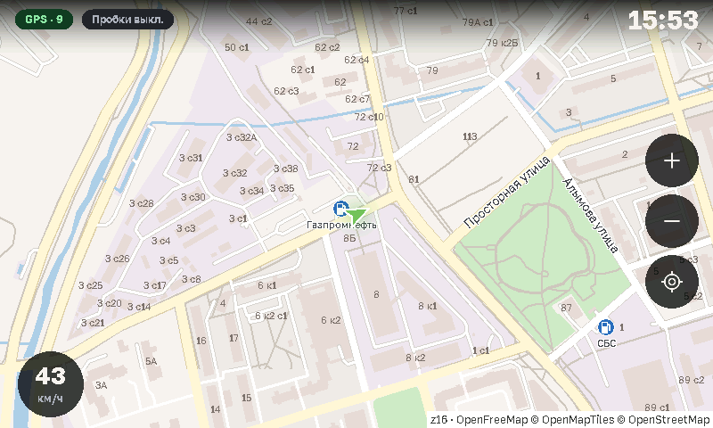
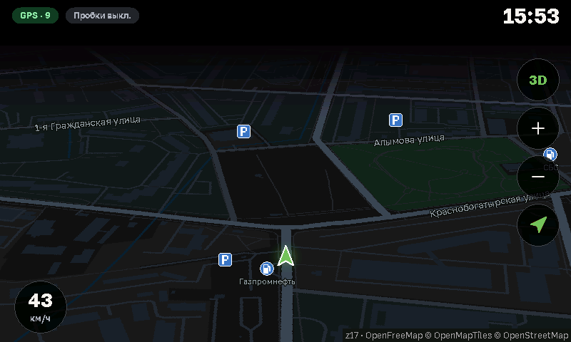
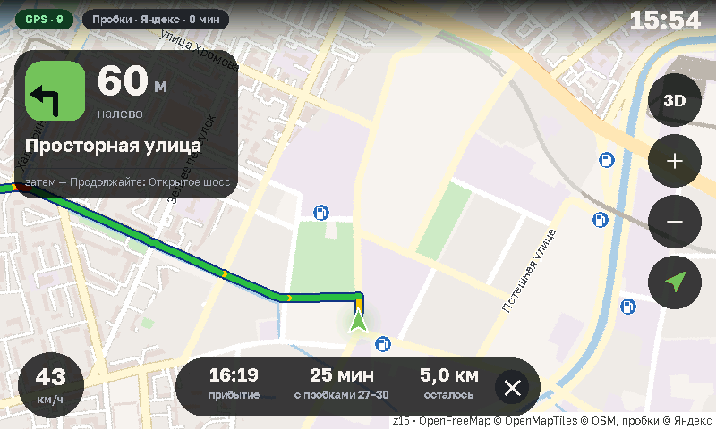

# OSMapsCE — user guide

**[Русская версия](manual.md)**

OSMapsCE is a navigation app on [OpenStreetMap](https://www.openstreetmap.org) maps for Windows CE devices with an
800×480 screen. Its main device is the Lada Vesta MMC head unit (HU). The app shows the map and traffic, finds
addresses, lays a route and guides you along it by voice. Search, routes and the vector map also work without internet
access once you download region maps. The app is free.

The version is shown in "Настройки → О программе" (Settings → About). The number looks like `2.1.YYMMDD`: the end is
the build date.

| Day | Night, 3D view | Route: traffic on the route |
|---|---|---|
|  |  |  |

The labels in quotes are the app's Russian labels as they appear on the screen, with a translation where it helps.
With the English interface ([section 11](#11-languages)) the screen shows the English labels instead.

**Contents**

1. [What OSMapsCE can do](#1-what-osmapsce-can-do)
2. [Installing and updating](#2-installing-and-updating)
3. [Offline maps](#3-offline-maps)
4. [The screen](#4-the-screen)
5. [Search](#5-search)
6. ["Куда едем?" (Where to?)](#6-куда-едем-where-to)
7. [Routes](#7-routes)
8. [Guidance on the way](#8-guidance-on-the-way)
9. [Favorites](#9-favorites)
10. [Settings](#10-settings)
11. [Languages](#11-languages)
12. [Voice prompts](#12-voice-prompts)
13. [Working with VestaHome](#13-working-with-vestahome)
14. [Where the data comes from](#14-where-the-data-comes-from)
15. [Log and help](#15-log-and-help)
16. [Our other apps](#16-our-other-apps)

---

## 1. What OSMapsCE can do

- **Map.** Raster (OSM tiles) or vector (OpenFreeMap). Day and night. A third-person view ("3D"). Places you have
  viewed are kept in a cache. → [section 4](#4-the-screen)
- **Offline.** A downloaded region gives a vector map, address search and routes. Between regions, routes follow the
  main roads. → [section 3](#3-offline-maps)
- **Traffic** from Yandex or 2GIS: on the map or only on the route line. Travel time with traffic.
- **Routes:** your own starting point, up to three stops, several alternatives to choose from, avoiding toll roads.
  → [section 7](#7-routes)
- **Guidance:** a maneuver card, a diagram of complex junctions, the arrival time, rerouting when you leave the route.
  In a tunnel without GPS the marker moves on along the route. After a restart the app offers to continue the route.
  → [section 8](#8-guidance-on-the-way)
- **Voice prompts** in Russian or English, without internet access. On the Lada Vesta they play over the radio.
  → [section 12](#12-voice-prompts)
- **Favorites:** up to 12 places, each with its own sign. → [section 9](#9-favorites)
- **Layers of a downloaded region:** traffic lights, speed bumps with a warning on the way, car parks, Moscow's paid
  street parking with prices. The road's speed limit sign.
- **Interface languages:** Russian and English. A new language is one text file. → [section 11](#11-languages)
- **With VestaHome:** the "Карта OSM" (OSM map) widget on the home screen, the theme color, a shared day / night
  mode, the maneuver in VestaHome's top bar, zoom with the steering wheel buttons.
  → [section 13](#13-working-with-vestahome)

---

## 2. Installing and updating

The app is the `OSMapsCE` folder. It holds `OSMapsCE.exe` and the folders `Images` (signs), `Fonts` (the font), `Lang`
(languages), `Voice` (voice prompts).

### First installation

1. Download the `OSMapsCE-<version>.zip` archive from [Releases](https://github.com/TpuPyku/OSMapsCE/releases).
2. Unpack the `OSMapsCE` folder to the device's memory card.
3. Run `OSMapsCE.exe`.

On the Lada Vesta with VestaHome, the "OSM карты" shortcut in "Приложения" (Apps) points to
`\SDMMC\OSMapsCE\OSMapsCE.exe` by default. Put the folder there or change the path in the shortcut.

At the first start the settings file `OSMapsCE.ini` appears next to the app. Later these appear there too:

- the `Cache` folder: map tiles you have viewed;
- `favorites.txt`: your favorite places;
- `route.txt`: the route you are driving. The file is deleted when the route ends or is cleared.

If you start the app a second time, it does not open again: the copy already running comes to the front.

### Updating

Unpack the new `OSMapsCE` folder over the old one. Settings, favorites and the cache are kept.

### Closing the app

The "ДОМОЙ" (Home) button does not close the app: the map keeps running behind. Close it in the settings: the power
button in the bottom right corner → "ЗАВЕРШИТЬ" (Close). The map and the route close, and the GPS port is free for
other programs.

---

## 3. Offline maps

### What a downloaded region gives

- the region's vector map (the "Вектор" (Vector) map type, [section 10](#map));
- address and place search;
- routes, including avoiding toll roads;
- layers: traffic lights, speed bumps, car parks, Moscow's paid street parking;
- the speed limit sign of the road you are on;
- the car marker kept on the road.

With the first region the "Обзорная карта и магистрали" (Overview map and main roads) pack is installed. It holds the
map for small zoom levels and the main roads graph for routes between regions. The app downloads the pack by itself
when it is missing or out of date.

There are regions of Russia, the CIS countries, Estonia, Latvia, Lithuania, Poland (by voivodeship), Germany (by state),
Czechia, Slovakia and Hungary. Maps on our own server are rebuilt every week, the copy on Yandex Disk on the 1st and
the 15th of the month.

### Where the maps are

The maps are in the `OSMapsData` folder in the root of any volume of the device or next to the app
(`OSMapsCE\OSMapsData`). On a PC, `OSMapsPC.exe` also looks one level up. Each region is its own folder inside
`OSMapsData`.

Regions downloaded on the device are written:

1. to the volume that already has an `OSMapsData` folder;
2. if there is none anywhere, to the removable volume with the most free space;
3. if there is no removable volume, next to the app.

### Downloading regions on the device

This needs internet access. "НАСТРОЙКИ" (Settings) → the "Карта" (Map) row, the "КАРТЫ" (Maps) button → the
"Карты областей" (Region maps) row, the "СКАЧАТЬ" (Download maps) button. The "Карты областей" screen opens with the list
from the catalog. A line at the bottom says what is going on: "Каталог областей…" (Region catalog…), "Областей: N"
(Regions: N) or "Каталог не получен (нет связи с GitHub?)" (Could not get the catalog (no connection to GitHub?)).

A region's row:

- the box and the title: a tap ticks the region or unticks it;
- a globe sign before the title: a region outside the former USSR. These regions are at the end of the list;
- the size and the state: "не найдена" (not on the device), "есть новее" (update available) or "последняя версия"
  (up to date);
- the "СЕРВЕР" (Server) button: download the region from our server;
- the "Я.ДИСК 05.11" button: download the copy from Yandex Disk, with the copy's date on the button. A clock sign on the
  button means the copy is older than the build on the server. "Я.ДИСК —" means there is no copy on the disk.

A region in the "есть новее" state downloads at once. For the others the button first asks "ТОЧНО?" (Sure?): press it
again. While a region downloads, its button reads "ОТМЕНА" (Cancel). The line at the bottom shows how many megabytes
have arrived, and at the end "записана" (saved), "загрузка остановлена" (download stopped) or "не скачана: нет связи
или нет места" (not downloaded: no connection or no space).

The bottom bar of the screen:

- the round "back" button on the left;
- "ИЗ: СЕРВЕР" / "ИЗ: Я.ДИСК" (From: server / From: Yandex Disk): where to download the ticked regions from;
- ‹ › and the page number;
- "СКАЧАТЬ (N)" (Download (N)): download the ticked regions one after another. While a download goes on, the button
  reads "ОТМЕНА";
- the round arrow on the right: load the catalog again.

### Downloading regions on a computer

The `OSMapsCE-Maps` program for Windows writes regions to a flash drive or a memory card. It is in the
[maps-app](https://github.com/TpuPyku/OSMapsCE/releases/tag/maps-app) release.

1. In the "Флешка / карта:" (Drive / card) line, choose the drive or a folder ("Папка…", Folder). "Обновить" (Refresh)
   reads the drive again.
2. Tick regions: click a row of the list or a region on the map. The mouse wheel zooms the map, dragging moves it.
   The "Все" (All), "Ничего" (None) and "Устаревшие" (Outdated) buttons tick regions in one go. "Поиск:" (Search)
   filters the regions by name.
3. Write the maps in one of two ways:
   - the button in a region's row: "⬇ скачать" (download, the "С сервера" (From the server) column) or "⬇ 05.11"
     (the "С Я.Диска" (From Yandex Disk) column) downloads a ready-made archive. "⚠ старая" (old) means the copy on the
     disk is older than the build on the server;
   - "Собрать выбранные карты" (Build the chosen maps) builds the ticked regions on the computer: the graph and the
     search from the release, the map tiles from the latest Protomaps build. This takes longer.
4. Put the drive into the device. The maps are in the `OSMapsData` folder in its root.

The list shows what is already on the drive and whether it is out of date. "Удалить с флешки" (Delete from the drive)
deletes the ticked regions from the drive. While writing, the main button reads "Отменить запись" (Cancel writing).
What has been downloaded stays on the computer, and the next writing continues from it. The "RU / EN" button switches
the program's language.

---

## 4. The screen

The map fills the whole screen.

**The top of the screen.** The clock is on the right. Two chips are on the left.

- The first one is GPS: "GPS · 9" (a position, 9 satellites, the chip is green), "GPS: поиск · 4" (searching, no
  position yet), "GPS: нет данных" (no data), "GPS: нет порта …" (no port), "GPS: порт … занят" (the port is busy),
  "GPS: поиск порта" (looking for the port), "GPS выкл." (GPS off).
- The second one is traffic or the network: "Пробки · Яндекс · 3 мин" (traffic · Yandex · updated 3 minutes ago),
  "Пробки · Яндекс · нет данных" (no data), "Пробки · на маршруте" (on the route), "Пробки выкл." (traffic off),
  "Загрузка…" (loading). A network error shows here for a minute: "Ошибка: нет соединения" (Error: no connection),
  "Ошибка HTTP 503" and the like. "Лимит запросов!" (Request limit!) means the day's traffic requests are used up
  ([section 14](#14-where-the-data-comes-from)). When car parks are on, it shows "Парковки" (Car parks),
  "Парковки · data.mos.ru", "Парковки · приблизьте карту" (zoom in) or "Парковки · нет в этом месте" (none here).

**Round buttons on the right** (top to bottom):

- "3D": the third-person view. The button is shown only in the heading-up mode at zoom 15 and closer. When the view is
  on, the label is in the accent color. The closer the zoom, the lower the camera;
- "+" and "−": the zoom, from 2 to 19. The current zoom is shown in the bottom right corner: `z15 · © OpenStreetMap…`;
- GPS: the follow mode. Taps switch it round:
  - off: the map stays where it is;
  - north-up: the car in the middle of the map (the setting after installation);
  - heading-up: the map turned along the way you drive, the car near the bottom of the screen;
- the sound button: turns the voice prompts off and on. It is shown only during a route.

**The car marker** is an arrow in the accent color with a glow. Without a fresh position (for more than 5 seconds) the
marker is grey. When the car stands in the north-up mode, the marker is a circle.

**The bottom bar.** A tap on the map raises the bar. After 6 seconds without a touch it goes down by itself: the orange
line above it shows the time left. Another tap on the map hides it at once. When the bar comes up, the app refreshes
the traffic if it is older than a minute. The buttons from left to right:

- "ДОМОЙ" (Home): back to VestaHome or VestaLaunch. The map keeps running behind. Without them the map goes to the
  background;
- "ПРОБКИ" (Traffic): round and round: traffic → car parks → nothing. While car parks are on, the button reads
  "ПАРКОВКИ" (Parking);
- "ЯНДЕКС" / "2ГИС": the traffic source. The button is shown only while traffic is on;
- "ПОИСК" (Search): [section 5](#5-search);
- "СБРОС" (Reset): clear the route. The button is shown only while there is a route;
- "НАСТРОЙКИ" (Settings): [section 10](#10-settings);
- "НОЧЬ" / "ДЕНЬ" (Night / Day): a dark or a light map. The button shows what a tap turns on.

Without a route, the "Куда едем?" (Where to?) card appears over the raised bar
([section 6](#6-куда-едем-where-to)).

**Gestures.**

- Dragging moves the map, and after you let go the map rolls on a little. Following the car turns off: turn it back on
  with the GPS button. In the 3D view the move is temporary: after 5 seconds the map goes back to the car.
- A long press (more than half a second) puts a pin and opens the point's card ([section 7](#7-routes)).
- A tap on a favorite place's sign opens its menu ([section 9](#9-favorites)).

**Speed.** When there is a position, the speed in km/h is shown in the bottom left corner. Next to it is the road's
speed limit sign. The sign comes from a downloaded region when the limit is tagged in OSM.

**A speed bump ahead.** When "Неровности" (Speed bumps) is on, at 15 km/h and faster the caption
"Неровность · 120 м" (Speed bump · 120 m) appears at the top. It shows 10 seconds of driving before the bump, but not
closer than 100 m.

**What the map shows.**

- Favorite places: signs from zoom 12, their names from zoom 14.
- Car parks: from zoom 14; red is paid, green is free, grey means the fee is not known.
- Traffic lights and speed bumps: from zoom 15, when they are on in the map settings.
- Moscow's paid street parking: lines along the streets from zoom 15. The color follows the price for the current day
  and hour by the device's clock: red is paid, green is free right now. From zoom 16 the lines show the price for a car
  in rubles per hour. The app does not recognize public holidays and shows the usual price. Data:
  [Moscow Government Open Data Portal](https://data.mos.ru/opendata/623), version of 2026-01-20. Prices may have
  changed, so check the signs.

Car parks, traffic lights and speed bumps come from a downloaded region. It must be a region built with these layers.

**Raster and vector map.** The raster map is OpenStreetMap tiles from the internet. Without a network you see what is
already in the cache. When a tile is missing, a coarser one is stretched in its place. The app draws the vector map
itself: from a downloaded region, small zoom levels from the overview map, the rest from OpenFreeMap over the internet.
While there is no map yet, the middle of the screen reads "Загрузка карты..." (Loading the map...). "Нет карты этой
области" (No map for this area) means there is no vector map here, neither on the device nor on the network.

**Night.** The raster map is darkened, the vector map is drawn in night colors. Traffic on the map is dimmed at night.

---

## 5. Search

"ПОИСК" (Search) on the bottom bar opens the keyboard. If the last search found something, its list opens first.

- The query field is at the top. Put the cursor with your finger; you can drag it along the field. When the text does
  not fit, ‹ › show at the edges.
- The bottom row of keys: "Aa" (capitals), "ENG" / "РУС" (the layout), "ПРОБЕЛ" (Space), "СТЕРЕТЬ" (Delete) and the
  main key.
- The main key: "НАЙТИ" (Find) when a query is typed; "ИЗБРАННОЕ" (Favorites) when the field is empty.
- The arrow in the top left corner closes the search.

After "НАЙТИ" a list of up to five places opens on the left over the map. A row shows the name, the address and the
distance from the car (without a position, from the map center). The places found are numbered on the map too. The
map moves to show them all.

- A tap on a place lays a route there from the car ([section 7](#7-routes)).
- A tap on the query field brings the keyboard back.
- A tap on the map beside the list closes the search, and the map goes back to where it was.

Messages in the list: "Поиск…" (Searching…), "Ничего не найдено" (Nothing found), "Нет связи с сервером поиска"
(Cannot reach the search server).

**Where it searches.** First in the downloaded region where the car is (without a position, the map center). When
there is no exact place or house there, the search also goes through the other downloaded regions. When the maps on
the device have nothing, the app asks the Photon server over the internet. In downloaded regions you may leave out
words such as "улица", "ул", "проспект", "шоссе" (street, avenue, highway), and you may write the town before the
street: "Жигулёвск Ткачёва 71".

**Favorites in the search.** The "ИЗБРАННОЕ" key with an empty field shows your favorite places. A tap on a place lays
a route. The ✕ button on the right deletes the place: the first tap asks "Удалить «…»?" (Delete "…"?), the second
deletes it.

---

## 6. "Куда едем?" (Where to?)

When there is no route, tap the map: the "Куда едем?" card appears above the bottom bar.

- The "Куда едем?" field opens the search.
- Under it are the first three favorite places with the distance to them. A tap lays a route to the place.

---

## 7. Routes

### The point's card

A long press on the map puts a pin. A card opens at the bottom: the point's address (or "Точка на карте" (Point on the
map) and the coordinates) and the distance "… от вас" (… from you).

- "Маршрут сюда" (Route here) opens the route editor: "Откуда" (From) is your location, "Куда" (To) is this point.
- "Заехать сюда" (Stop here), only during a route: the point becomes a stop, and the route is laid again. The app puts
  it where it lengthens the way least. After three stops the button is replaced by "уже три «Заехать»" (three stops
  already).
- "В избранное" (Add to favorites): [section 9](#9-favorites). During a route it is a button with a star.

A tap on the map beside the card closes it.

### The route editor

The "Маршрут" (Route) panel is on the left over the map. The rows go top to bottom: "Откуда" (From, marker А), the
stops "Заехать" (Stop; 1, 2, 3), "Куда" (To, marker Б).

- A tap on a row opens the choices beside the panel: "Моё местоположение" (My location, for "Откуда" only),
  "Найти адрес" (Find an address), "Избранное" (Favorites), "Точка на карте" (Point on the map), "Отмена" (Cancel).
- "Точка на карте": "Нажмите на карту: точка для «Куда»" (Tap the map: a point for "To") appears at the top. Tap the
  place you need. "ОТМЕНА" (Cancel) goes back to the editor.
- "+ Заехать" (+ Add a stop) adds a stop, up to three. The × button in a stop's row removes it.
- "ПОЕХАЛИ" (Start) lays the route. The button is in the accent color when "Куда" is chosen. Without it the app says
  "Выберите, куда ехать" (Choose where to go). Empty "Заехать" rows are dropped.
- A tap beside the choices closes them. A tap on the map beside the panel closes the editor.

**Where the route starts.** "Моё местоположение" (My location) is the car. Without a position the route starts at the
last place GPS reported (the row reads "Последнее местоположение", Last known location). If GPS has not worked yet,
the route starts at the map center ("Центр карты", Map center). You can also choose another start: an address, a
favorite or a point. Then after "ПОЕХАЛИ" the map shows the start of the route.

A route from the search, from "Куда едем?" and from a favorite is laid at once from your location, without the editor.

### Route alternatives

For a new route without stops the server may offer several alternatives. Then a panel opens on the left: from (А) and
to (Б) at the top, a card for each alternative below.

- A card shows the travel time and the length.
- Under them is an estimate by the traffic on this way: "с пробками ~25 мин" (with traffic ~25 min) or
  "с пробками 25–40 мин" (with traffic 25–40 min). The color: green means traffic adds at most a third of the time,
  the accent color more than a third, red a jam longer than 300 m on the way.
- Lower is the worst jam: "пробка 1,2 км" (jam 1.2 km) or "без сильных пробок" (no heavy traffic). "видно 60% пути"
  (60% of the way seen) means traffic is known only for that part of the way.
- "пробки выключены" (traffic is off) and "пробок на пути не видно" (no traffic seen on the way) mean there is no
  estimate.

A tap on a card shows that alternative on the map, and its card gets a frame in the accent color. The other
alternatives show as grey lines with numbers. "ПОЕХАЛИ" takes the alternative shown. It is also taken if you tap the
map or drive faster than 15 km/h.

### The route on the map

The route is a blue line. When traffic is on, the line is colored by the traffic. A start that is not the car is marked
with a green А marker. Stops are numbered markers in the accent color, the end is a ring.

**Stops during a route.** A long press on a stop's marker opens the "Заехать N" (Stop N) menu: "УБРАТЬ ТОЧКУ" (Remove),
"РАНЬШЕ" (Earlier: swap with the previous stop), "ОТМЕНА" (Cancel). After a choice the route is laid again. A stop you
have passed leaves the route by itself.

**Clearing the route:** the × button in the trip card at the bottom or "СБРОС" (Reset) on the bottom bar.

### Where the route comes from

1. When the start, all stops and the end are in one downloaded region, the route is laid on the device.
2. Otherwise the app asks the routing server over the internet. The server does not take traffic into account.
3. Without internet access the route follows the main roads graph. When the start and the end are in downloaded
   regions, the way to the main roads also follows their roads.

Messages: "Расчёт маршрута…" (Calculating the route…), "Маршрут не найден" (Route not found), "Маршрут не построен"
(No route built), "Нет связи с сервером" (Cannot reach the server), "Ошибка сервера N" (Server error N),
"Лимит запросов на сегодня" (Request limit for today), "Нет сети, а между областями нужны магистрали (КАРТЫ)" (No
network, and routes between regions need the main roads (MAPS)). The last one means the "Обзорная карта и магистрали"
pack is not on the device ([section 3](#3-offline-maps)).

---

## 8. Guidance on the way

### The maneuver card

The next maneuver is shown in the top left.

- Far away: a small card with the maneuver's sign and the distance.
- Closer than 300 m (at speed, 20 seconds of driving before it): a big card with the sign, the distance, what to do
  ("Поверните направо" (Turn right), "Держитесь левее" (Keep left), "На кольце 2-й съезд" (At the roundabout, exit
  2)…), the road's name. Below it the line "затем — …" (then: …) with the maneuver after it.

**Junction diagram.** When it is on ("Настройки → Маршрут", Settings → Route), before a fork, an exit, an entry, a
roundabout or a merge a piece of the map around the maneuver appears under the big card. The map is turned so that the
way in points up. The route on it is a line in the accent color with an arrow. The diagram shows 300 m before the
maneuver, at speed 15 seconds of driving before it.

**Zoom before a complex maneuver.** In the heading-up mode the map zooms in to level 17 by itself before such
maneuvers and returns to your zoom after the maneuver. If you change the zoom yourself meanwhile, the app keeps yours.

### The trip card

At the bottom in the middle: the arrival time by the clock ("прибытие", arrival), the time on the way ("в пути", on
the way), the distance left ("осталось", left). When traffic is on and the estimate spreads over two minutes or more,
"с пробками 25–40" (with traffic 25–40) replaces "в пути". On the right is the × button: clear the route. A tap on the
card itself opens the editor with this route's points. While the bottom bar is up, the trip card is hidden.

### Leaving the route

When the car is farther than 50 m from the line for four GPS fixes in a row at more than 5 km/h, the small card turns
red: "Вне маршрута, перестраиваю…" (Off the route, recalculating…). A new route is laid from the car, but not more
often than once in 15 seconds. A route that does not start at the car is not laid again.

### The marker on the road

Near the route line (within 30 m) the car marker sits on the line. Without a route the marker sits on a road of a
downloaded region in the same way. Faster than 10 km/h this happens only when the car drives along the road.

### Tunnels

When GPS is lost in a tunnel on the route, the marker moves along the route line at the same speed until the exit, and
the prompts go on. Meanwhile the marker is grey. This happens when the speed was over 10 km/h and the map data shows a
tunnel on the route ahead. The marker goes 5 km at most and 3 minutes at most. Outside tunnels the marker without GPS
stays where it is.

### The end of the route

30 m from the destination the app says "Вы приехали" (You have arrived). After 10 seconds the route is cleared.

### Continue the route

If the app was closed or the HU was switched off during a route, the next start asks "Продолжить маршрут?" (Continue
the route?). Under the question are the destination and the number of stops.

- "Да" (Yes): the route to the same destination through the stops left, from the car. The app waits up to 15 seconds
  for a position.
- "Нет" (No): the route is forgotten, the question does not come again.
- A tap beside the card closes it. The question comes again at the next start.

---

## 9. Favorites

Up to 12 places. Each has a short name (up to 23 letters) and a sign: star, home, work, flag, heart, filling station,
cottage, block of flats, shop, hospital, school, car park.

**Adding.** A long press on the map → "В избранное" (Add to favorites). Type a name, for example "Дом" (Home) or
"Работа" (Work), and press "СОХРАНИТЬ" (Save). The place's card opens at once: choose a sign and press "Готово" (Done).

**The sign on the map.** A tap on a place's sign opens its menu: the name, the distance "Избранное · … от вас"
(Favorites · … from you), the buttons "Маршрут сюда" (Route here) and "Изменить" (Edit). "Маршрут сюда" lays the route
at once. "Изменить" opens the place's card:

- twelve signs: a tap chooses a sign;
- "Имя" (Name): opens the keyboard;
- "Удалить" (Delete): the first tap asks "Точно?" (Sure?), the second deletes;
- "Готово" (Done): close.

**The list.** "Настройки → Маршрут → Избранное" (Settings → Route → Favorites), the "ИЗМЕНИТЬ" (Edit) button. The
"Избранное" page shows six places at a time. A row shows the sign, the name and the coordinates, with buttons on the
right:

- up and down arrows: the order of the places;
- "ИМЯ" (Name): rename;
- "УДАЛИТЬ" (Delete): the first tap asks "ТОЧНО?" (Sure?), the second deletes.

A tap on the sign or the name opens the "Значок: …" (Sign: …) page to choose a sign.

The order matters. "Куда едем?" shows the first three places, the VestaHome widget the first two.

**Where else.** Favorites are in the search (the "ИЗБРАННОЕ" key with an empty field) and in the route editor
("Избранное" in a row's choices).

---

## 10. Settings

"НАСТРОЙКИ" (Settings) on the bottom bar. The "Настройки карты" (Map settings) screen: the clock at the top, the rows
below. The ‹ › arrows in a row change the value, and it applies at once. The round button in the bottom left corner
goes back to the map, the power button in the bottom right closes the app ([section 2](#closing-the-app)). The windows
that open from the bottom close with the "ГОТОВО" (Done) button or with a tap above the window.

### Map

Under the row's name is the map type. The "КАРТЫ" (Maps) button opens the "Карта" (Map) screen:

- **Вид** (Type): "Растр" (Raster: OSM tiles) or "Вектор" (Vector: OpenFreeMap and downloaded regions). After
  installation it is "Растр".
- **Детализация** (Detail): for the vector map, "Авто" (Auto), "Полная" (Full), "Средняя" (Medium), "Быстрая" (Fast).
  Less detail draws faster. "Авто" chooses by the device's speed; the line under the row shows the current choice.
- **Пробки** (Traffic): "Везде" (Everywhere: on the map and on the route line) or "Маршрут" (Route: only on the route
  laid).
- **Светофоры** (Traffic lights): traffic light signs from a downloaded region. Off after installation.
- **Неровности** (Speed bumps): speed bump signs and the warning on the way. On after installation.
- **Карты областей** (Region maps): the "СКАЧАТЬ" (Download maps) button ([section 3](#downloading-regions-on-the-device)).

### Route

Under the row's name is what is on: "голос: вкл · развязка: выкл · платные: можно" (voice: on · junction: off · tolls:
allow). The "НАСТРОИТЬ" (Set up) button opens a window:

- **Схема развязки** (Junction diagram): "Вкл" (On) or "Выкл" (Off) ([section 8](#the-maneuver-card)). Off after
  installation.
- **Платные дороги** (Toll roads): "Можно" (Allow) or "Объезжать" (Avoid). Avoiding works only for routes over the
  maps on the device. The routing server on the internet does not avoid toll roads. With "Объезжать" the app first
  tries the main roads graph.
- **Голосовые подсказки** (Voice prompts): "Выкл" (Off), "Тихо" (Quiet), "Средне" (Medium), "Громко" (Loud)
  ([section 12](#12-voice-prompts)).
- **Избранное** (Favorites): "мест: N из 12" (places: N of 12), the "ИЗМЕНИТЬ" (Edit) button
  ([section 9](#9-favorites)).

### Map cache

Under the name is the space used. The arrows set the limit: 250 MB, 500 MB, 1 GB or 2 GB. It starts at 500 MB. When the
cache is over the limit, the app deletes the oldest files.

### Log

"Вкл" (On) or "Выкл" (Off). Under the name is where the log is written, "некуда писать: нет карты памяти" (nowhere to
write: no memory card) or "OSMapsCE.log: выключен" (OSMapsCE.log: off) ([section 15](#15-log-and-help)).

### GPS

Under the name is the receiver's state: the port, the speed, the number of satellites, " · фикс" (fix) when there is a
position. "COM4 занят другой программой" (COM4 is used by another program), "COM4 не открывается" (COM4 does not open),
"выключен (gps=0)" (off) mean the port does not work.

The app only reads the GPS port and picks the NMEA sentences from the stream. The default is `COM4:` at 115200, the
Lada Vesta's GPS port. If VestaHome already reads the GPS port, OSMapsCE takes the data from it. If the port is held by
CityGuide, OSMapsCE closes CityGuide (the `kill` key in the settings file).

The "НАСТРОИТЬ" (Set up) button opens the "GPS" window:

- **Порт** (Port): COM1…COM9.
- **Скорость порта** (Port speed): 4800…115200 or "не менять" (keep: as the shell set it).
- The line "NMEA 1250 (ошибок 3) · 55.75580, 37.61730": how many lines came, how many with errors (ошибок), the
  position.
- The last line from the receiver, or a hint: "Нет строк — не тот порт. Строки с ошибкой — не та скорость." (No lines:
  wrong port. Lines with errors: wrong speed.)
- "НАЙТИ GPS" (Find GPS) tries the ports COM1…COM9 and the speeds. The port found is saved: "Найден GPS: …, настройки
  сохранены" (GPS found: …, settings saved). If nothing is found: "GPS не найден на COM1…COM9" (No GPS found on
  COM1…COM9).

The port and the speed are kept for each device separately. You can move one memory card between the HU and another
navigator.

### Язык / Language

The interface language ([section 11](#11-languages)).

### О программе (About)

The version number. The "ЗАПРОСЫ" (Requests) button shows "Запросы за день" (Requests today): Yandex and 2GIS traffic
(how many of how many), OSM tiles, search and routes (how many of how many).

### The OSMapsCE.ini file

Almost everything can be changed on the screen. Edit the file while the app is closed: the app rewrites it itself.

| Key | After installation | Meaning |
|---|---|---|
| `traffic_src` | yandex | traffic source: yandex or 2gis |
| `traffic_route` | 0 | 1: traffic on the route line only |
| `traffic_ttl` | 10 | minutes before the traffic is refreshed |
| `yandex_limit`, `2gis_limit` | 900, 2000 | traffic requests per day |
| `auto_reserve` | 100 | how many requests before the limit to keep for manual refreshes |
| `api_limit` | 300 | search, address and route requests per day |
| `voice`, `voice_vol` | 1, 3 | voice prompts; volume 1 quiet, 2 medium, 3 loud |
| `vector` | 0 | map type: 0 raster, 1 vector |
| `detail` | 0 | vector map detail: 0 auto, 1 full, 2 medium, 3 fast |
| `junction` | 0 | 1: junction diagram |
| `no_toll` | 0 | 1: avoid toll roads |
| `layer_signals`, `layer_bumps` | 0, 1 | traffic lights, speed bumps |
| `cache_mb` | 500 | cache limit, MB |
| `cache_days` | 7 | days before a tile is checked against the server (0: never) |
| `gps`, `gps_port@<device>`, `gps_baud@<device>` | 1, COM4:, 115200 | GPS on/off, port, speed (0: keep) |
| `kill` | CityGuideCE.exe | the program to close if it holds the GPS port (empty: never) |
| `hide_taskbar` | 1 | hide the taskbar |
| `lang` | empty | language: the file `Lang\<lang>.txt`, empty for Russian |
| `log` | 0 | the log |

The other keys hold the app's state and counters.

---

## 11. Languages

"Настройки → Язык / Language" (Settings → Language), the ‹ › arrows. The language changes at once. There are Russian
and English. Names on the map and region names stay as they are in the OSM data.

A new language is one file in the `Lang` folder next to the app. Copy `en.txt` as `<code>.txt` (for example, `de.txt`)
and replace the translations. The first line `#name …` is the language's name in the settings. After it, each line
holds the Russian text, a tab and the translation. `%d`, `%s` and the like must stay in the same order, or the line is
not used. There is no need to rebuild the app.

---

## 12. Voice prompts

A female voice. The prompts are in Russian when the app's language is Russian and in English with any other language.
No internet is needed: the phrases are in the `Voice\ru` and `Voice\en` folders.

**What you hear.**

- "The route is ready. Let's go!", "The route has been recalculated.", "Waypoint reached.", "You have arrived!".
- Each maneuver is announced up to three times: in advance, closer and just before the maneuver. For example: "In three
  hundred meters turn right". When the next maneuver comes within 200 m after this one, "Then …" is added.

**When.** The faster the car, the earlier the prompt:

| Speed | In advance | Closer | Just before |
|---|---|---|---|
| 80 km/h and faster | 2 km | 800 m | 7 seconds of driving before it |
| 50 km/h and faster | 1 km | 300 m | 7 seconds of driving before it |
| slower | 500 m | 200 m | 7 seconds of driving before it, not closer than 40 m |

A prompt that comes too late is skipped. Off the route there are no prompts.

**Volume and turning off.** "Настройки → Маршрут → Голосовые подсказки" (Settings → Route → Voice prompts): "Выкл"
(Off), "Тихо" (Quiet), "Средне" (Medium), "Громко" (Loud). The sound button on the right of the map during a route
turns the voice off and on at the chosen volume.

**On the Lada Vesta** a prompt plays over the radio and the music, as with the stock navigators. The sound is turned
down a second before the phrase and comes back after it. With the stock shell the shell does this, without it
VestaHome does.

---

## 13. Working with VestaHome

[VestaHome](https://github.com/TpuPyku/VestaHome) is our shell for the Lada Vesta. When it runs, OSMapsCE works
together with it.

- **The "Карта OSM" (OSM map) widget** on VestaHome's home screen. Show or hide it in "Настройки → Общие → Виджеты
  главной" (Settings → General → Home widgets).
  - While OSMapsCE is not running, the widget shows the first two favorite places. A tap on a place starts OSMapsCE
    with a route there. A tap elsewhere on the widget starts the map.
  - While OSMapsCE runs, the widget shows a live map around the car. During a route the map is turned along the way
    you drive and shows the next maneuver, the arrival time, the time on the way and the distance left.
  - A tap on the widget opens the map on the full screen.
- **The maneuver in the top bar.** During a route, VestaHome's other screens show the next maneuver in the top bar. A
  tap on it opens the map.
- **The accent color** comes from VestaHome's theme. When VestaHome is not running, the color comes from its settings
  file. When there is no such file, the color is orange.
- **Day and night** are shared: the "НОЧЬ" (Night) button in OSMapsCE switches VestaHome too, and the other way round.
- **Steering wheel buttons.** While the map is on the screen, holding the "up" and "down" buttons (and also "phone" and
  "hang up") zooms the map in and out. Short presses stay with VestaHome: music and phone.
- **"ДОМОЙ"** (Home) goes back to VestaHome, and the map keeps running.
- **GPS** is shared: if VestaHome already reads the GPS port, OSMapsCE takes the data from it.
- **Voice prompts** play over the radio ([section 12](#12-voice-prompts)).

---

## 14. Where the data comes from

- **Raster map:** [OpenStreetMap](https://operations.osmfoundation.org/policies/tiles/) tiles over HTTPS, cached. The
  OSM rules forbid bulk downloading.
- **Vector map:** [OpenFreeMap](https://openfreemap.org), OpenMapTiles data. Region tiles for offline use are cut from
  [Protomaps](https://protomaps.com) builds. Road graphs and search are built from [Geofabrik](https://download.geofabrik.de)
  and [openstreetmap.fr](https://download.openstreetmap.fr) extracts.
- **Yandex traffic:** the Static API without a key. Regularly exceeding the limit blocks access.
  [Terms](https://yandex.ru/dev/commercial/doc/ru/).
- **2GIS traffic:** tiles from the server of the [RasterJS API](https://github.com/2gis/mapsapi) library, over 200
  cities. The address may change. Non-commercial use only, under the
  [2GIS license](https://github.com/2gis/mapsapi/blob/master/LICENSE).
- **Search and a point's address:** downloaded regions, otherwise [Photon](https://photon.komoot.io). A search runs on
  the "НАЙТИ" (Find) key. The app asks for a point's address on a long press and when you pick a point on the map.
- **Routes:** downloaded regions, otherwise OSRM on the [FOSSGIS](https://routing.openstreetmap.de) servers, without
  traffic.

**Limits.** Traffic is limited by the number of requests per day: Yandex 900, 2GIS 2000. The app keeps the last 100
requests before the limit for refreshes caused by your actions: moving the map, zooming, tapping the map. Search,
addresses and routes: 300 requests per day, and answers from downloaded regions count too. The search and routing
servers are free and meant for moderate use. The counters are in "Настройки → О программе → ЗАПРОСЫ" (Settings →
About → Requests).

Map data © OpenStreetMap contributors, [ODbL](https://www.openstreetmap.org/copyright).

---

## 15. Log and help

The log is off by default. The switch is "Настройки → Журнал" (Settings → Log). The file `OSMapsCE.log` holds
requests, network errors, GPS and routes. When the file reaches 256 KB, it becomes `OSMapsCE.old.log`, and a new one
starts.

On the Lada Vesta the log is written only to an SD card or a flash drive, into the `VestaLogs` folder. It is never
written to the HU's built-in memory. Without a card or a flash drive there is no log. On other devices the log goes
to the memory card, and without one next to the app.

**If something is wrong.**

- "Ошибка HTTPS" (HTTPS error) most often means a wrong date on the device and no GPS signal. To check certificates
  the app also takes the date from GPS.
- Delete `OSMapsCE.ini` to get the default settings back. The `Cache` folder can be deleted too.

If you have a problem, send `OSMapsCE.log` and `OSMapsCE.old.log`. Questions and bugs go to
[Issues](https://github.com/TpuPyku/OSMapsCE/issues).

---

## 16. Our other apps

- **VestaHome**: a shell for the Lada Vesta HU: radio, music, phone, internet, widgets. With it, OSMapsCE adds the
  "Карта OSM" widget to the home screen. [github.com/TpuPyku/VestaHome](https://github.com/TpuPyku/VestaHome)
- **YaMapsCE**: the Yandex map with traffic. [github.com/TpuPyku/YaMaps](https://github.com/TpuPyku/YaMaps)
- **VestaLaunch**: starts programs from the stock shell's "Навигация" (Navigation) button.
  [github.com/TpuPyku/VestaLaunch](https://github.com/TpuPyku/VestaLaunch)

---

**If you like it**, give the repository [github.com/TpuPyku/OSMapsCE](https://github.com/TpuPyku/OSMapsCE) a ⭐ star (the **Star** button at the top of the page): it helps others find the app. You can support the development on [Boosty](https://boosty.to/vesta_home): it is voluntary, OSMapsCE stays free.

## License

© 2026 TpuPyku, GNU GPL v3 (`LICENSE`): you may use, change and distribute it, including for money, only together with
the source code of all changes under the same license. Map data © OpenStreetMap contributors, ODbL.
